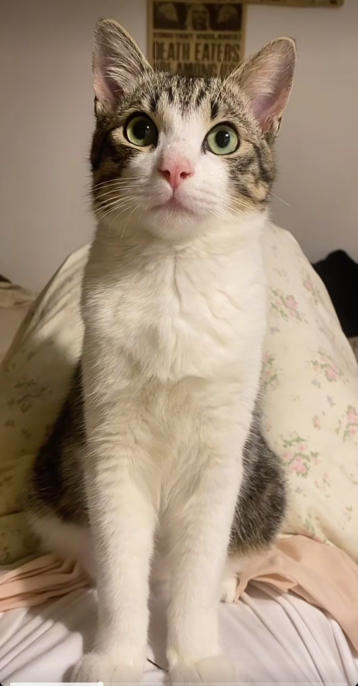
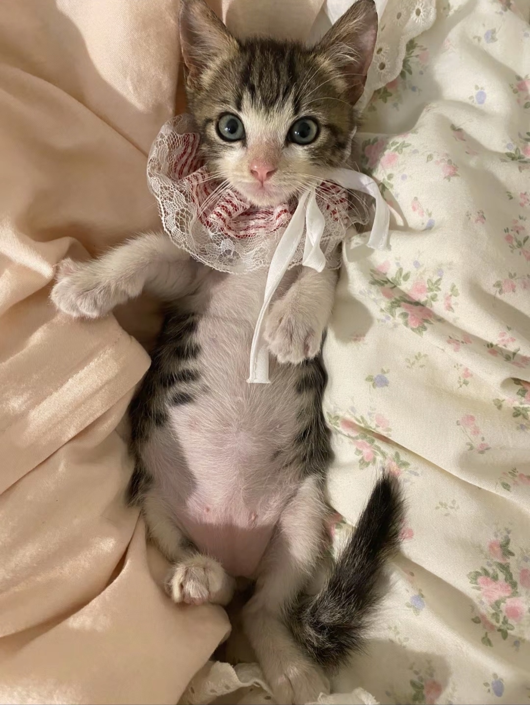
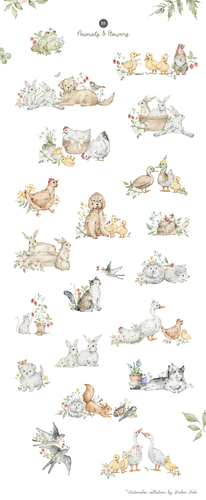
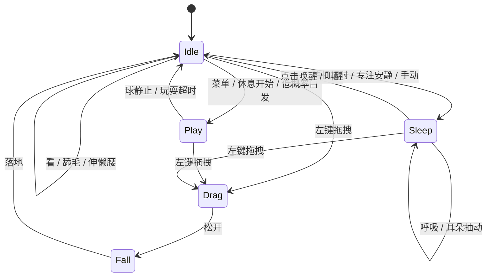
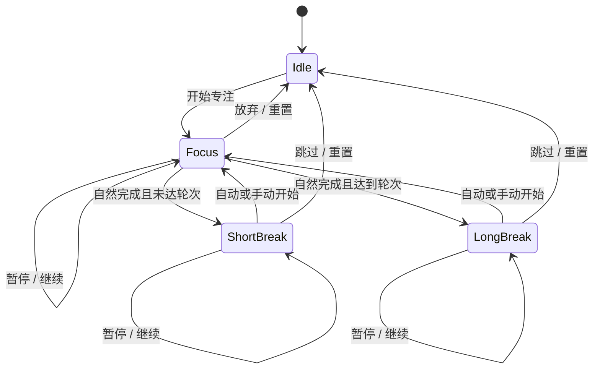
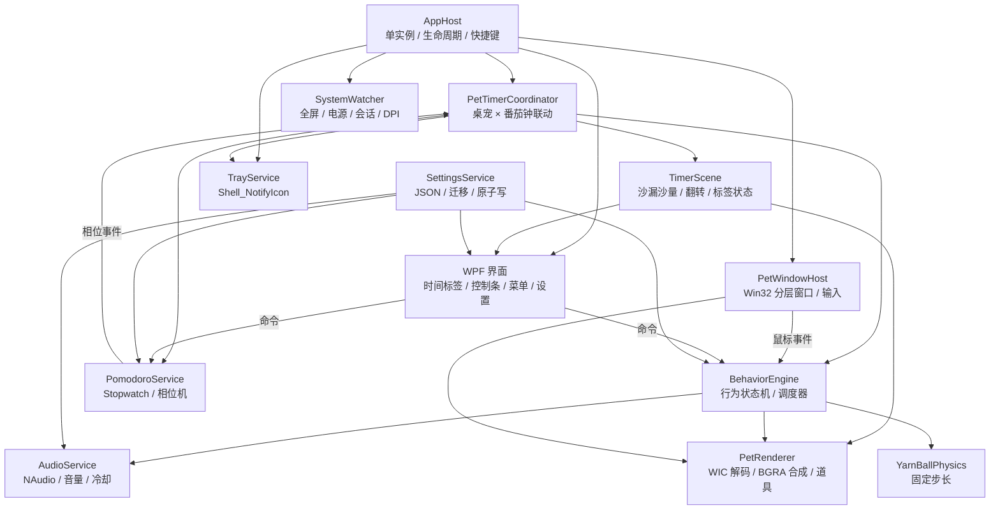

# 「开心」猫咪桌宠 · 设计文档

| 项目   | 内容                                                 |
| ---- | -------------------------------------------------- |
| 文档版本 | v0.1（设计稿，待评审）                                      |
| 日期   | 2026-10-26                                         |
| 目标系统 | Windows 11 22H2（Build 22621）及以上，x64                |
| 代号   | KaixinPet                                          |
| 角色原型 | 本目录四张照片中的灰虎斑小猫，暂命名「开心」；最终设计不保留白围兜，四肢保留自然白色，不佩戴任何配饰 |
| 文档用途 | 产品定义、交互与视觉规范、技术方案、验收标准、开发计划                        |

---

## 0. 摘要与关键决策

一句话定义：

> **一只安静陪你工作的桌面小猫。平时待在屏幕角落发呆、打盹；你开始番茄钟时它搬出沙漏、安静陪读，休息时叼来毛线球；所有叫声都可以换成你自己的音频。**

关键决策：

| 决策   | 结论                                        | 理由                                                     |
| ---- | ----------------------------------------- | ------------------------------------------------------ |
| 技术栈  | C# + WPF（.NET 10）+ Win32 分层窗口             | 无 Electron/WebView，原生透明窗口、逐像素点击穿透、低内存、开发效率高            |
| 桌宠渲染 | 自绘 Win32 `UpdateLayeredWindow` + BGRA 帧合成 | 连续动画不受 WPF 透明窗口限制；透明区域自动穿透；逐帧开销极小                      |
| 界面   | WPF 小组件：沙漏上方的一体式计时面板（收起为时间标签，悬停展开控制）、右键菜单、设置 | 时间信息跟随沙漏，不常驻大面板；只在需要时出现                                |
| 宠物窗口 | 固定 320×280 DIP 的小窗口，非全屏覆盖层                | 避免遮挡、输入冲突和性能问题                                         |
| 动画来源 | 2 倍分辨率水彩手绘帧 + 独立表情/特效叠加层                  | 参考图的水彩质感 + 真实猫咪特征，同时控制内存                               |
| 番茄钟  | 参考 Pomotroid 的自定义时长、轮次、长休息、托盘、自动流转        | 保留核心效率功能；不做主题包等非必要体积                                   |
| 计时呈现 | 专注开始时猫搬出沙漏，时间只悬浮在沙漏上方；不常驻大计时气泡            | 减少 UI 存在感；沙漏本身承担进度反馈；控制藏在悬停/右键/托盘                      |
| 声音   | 逐事件替换猫叫；导入后本地转码缓存                         | 支持 WAV/MP3/M4A/FLAC，不依赖原文件位置                           |
| 通知   | v1 用沙漏时间标签 + 托盘气泡 + 音效，不引入系统 Toast SDK    | 避免额外 25MB 级 Windows SDK 投影依赖，符合轻量目标；系统 Toast 作为 P1 可选项 |
| 网络   | 无网络请求、无账号、无遥测                             | 隐私友好，也减少故障面                                            |

硬性轻量指标（Lite 版，参考机为 4 核 CPU / 16GB 内存 / 1080p 100% 缩放）：

| 指标               | 目标                                      |
| ---------------- | --------------------------------------- |
| 安装包体积            | ≤ 20MB（不含共享 .NET 运行时）                   |
| 安装后占用            | ≤ 45MB                                  |
| 常驻内存（空闲，私有工作集）   | ≤ 90MB                                  |
| 活跃内存（玩毛线球时）      | ≤ 130MB                                 |
| 空闲 CPU（任务管理器总占用） | ≤ 0.5%                                  |
| 玩毛线球 CPU         | ≤ 4%                                    |
| 冷启动到猫出现          | ≤ 1.2 秒                                 |
| 动画帧率             | 待机 8–12fps，玩耍/拖拽最高 24fps；不做 60fps 无意义动画 |
| 网络连接             | 0（运行期）                                  |

> 部署说明：Lite 版采用框架依赖部署，需要 **.NET 10 Desktop Runtime**。安装器会检测并引导安装；同时提供体积较大的自包含便携版（约 90MB，含运行时）给无法安装运行时的机器。若未来把“零运行时安装”列为硬性要求，可将同一套代码改为 .NET Framework 4.8 构建，核心逻辑不变。

---

## 1. 产品定义

### 1.1 产品定位

面向 Windows 11 的轻量桌面陪伴工具，把「桌宠」和「番茄钟」做成同一个体验：

- 桌宠不是装饰性的循环 GIF，而是有呼吸、会眨眼、会打盹、会回应你的小猫。
- 番茄钟不是一个冷冰冰的悬浮窗，而是通过猫的状态表达专注与休息。
- 音效不是固定提示音，而是可以逐项换成用户自己的猫叫。

### 1.2 要解决的问题

| 问题          | 现状               | 本产品的做法             |
| ----------- | ---------------- | ------------------ |
| 长时间用电脑缺少陪伴感 | 桌宠软件往往笨重、花哨、打扰工作 | 一只安静、低打扰、随时可隐藏的猫   |
| 番茄钟切走注意力    | 独立计时器界面、频繁弹窗     | 猫的状态就是进度提示，悬浮信息克制  |
| 现有桌宠不关注工作节奏 | 只会播放动画           | 专注时陪读、休息时玩耍、结束时提醒  |
| 音效无法个性化     | 固定音效、重复烦人        | 每个事件可替换；音量、冷却、静音可控 |

### 1.3 设计原则

1. **轻**：不做常驻 Chromium，不做全屏覆盖层，不联网，不驻留多个进程。
2. **安静**：专注期间不主动打断；声音有冷却和音量上限；任何提示都能关掉。
3. **有生命力**：待机不是单帧；有微表情、微动作、不同时长的行为组合。
4. **可控**：右键、托盘、快捷键都能快速隐藏、静音、暂停或退出。
5. **可替换**：音效可自定义；角色资源按目录组织，为后续皮肤留出口，但不为未来过度设计。

### 1.4 非目标（v1 不做）

- 不做多平台（仅 Windows 11 x64；ARM64 在 P1 验证）。
- 不做 AI 对话、语音助手、账号体系、云同步。
- 不做喂养/等级/金币/商城等游戏化系统。
- 不做多宠物、皮肤商城、在线音效库。
- 不做全屏透明覆盖层；猫不会被允许在全屏游戏中漫游。
- 不做 Windows 10 专门适配（理论可用，但不作为验收目标）。
- 不在 v1 做自动更新；个人自用，不购买代码签名证书，也不做联网更新检查。
- 不做逐主题换肤；仅跟随系统浅色/深色，保持体积和一致性。

### 1.5 成功标准

功能成功：

- 三类核心动作（待机、玩毛线球、睡觉）均有完整、可打断、可恢复的表现。
- 番茄钟可靠完成，错误/休眠/全屏等边界不丢状态。
- 每个音效事件都可以单独替换、试听、还原。
- 全流程无需管理员权限，卸载可保留或清除个人数据。

体验成功：

- 连续使用 7 天后仍愿意保留桌宠，不因提醒或动画感到烦躁。
- 在 1080p / 150% / 双屏混合 DPI 下都清晰、不跑位。
- 工作时隐藏或静音的操作不超过两次点击。

技术成功：

- 达到第 0 节的性能指标；8 小时浸泡测试无崩溃、无明显内存增长。

---

## 2. 用户与场景

### 2.1 目标用户

| 用户        | 特征                 | 核心诉求             |
| --------- | ------------------ | ---------------- |
| 居家/办公室工作者 | 长时间面对电脑，桌面是主要工作区   | 低打扰陪伴、专注节奏提醒     |
| 学生        | 需要番茄钟，但不想安装复杂的学习软件 | 一键专注、休息提醒、可自定义时长 |
| 猫主人       | 对角色有情感连接，愿意折腾音效    | 像自己的猫；能替换叫声；外形耐看 |

### 2.2 典型场景

1. **开机后的角落陪伴**：开机自启（可选），猫出现在右下角，眨眼、舔毛、打盹；用户完全不用管它。
2. **开始专注**：双击猫或按 `Ctrl+Alt+P`，猫搬出沙漏、在桌边坐好；数字时间只以一小条悬浮标签出现在沙漏上方，没有大面板。
3. **专注结束**：猫轻碰沙漏、开心地叫一声；时间标签淡出，托盘气泡提示休息；如果开启了自动休息，猫把沙漏翻个面，绿色休息计时开始，随后叼出毛线球。
4. **休息玩耍**：用户点「陪它玩」或等它自己玩；毛线球在窗口内弹跳，猫扑、拍、追；球静止后结束。
5. **下班/夜间**：长时间未互动，猫蜷起来睡；点击或拖动会先醒来伸懒腰。
6. **个性化**：用户把「被摸」的提示音替换成自己猫的呼噜声；导入时自动试听、归一化、缓存。
7. **专注被打断**：用户按暂停，猫疑惑地歪头；用户离开，系统休眠后计时自动暂停，回来提示是否继续。

### 2.3 首次使用旅程

1. 安装（无需管理员，默认当前用户目录）。
2. 启动后右下角出现猫，首次弹出一个很轻的提示气泡：  
   「喵～ 我是开心。双击我开始番茄钟，我会把沙漏搬出来；右键可以设置。」
3. 用户可选择立即开始 25 分钟专注，或点击「先逛逛」关闭提示。
4. 不强制开机自启、不强制登录、不请求网络权限。
5. 托盘常驻，右键托盘可随时隐藏/退出。

---

## 3. 角色与核心动作

### 3.1 角色设定

角色以本目录照片为原型：

- 灰褐色虎斑猫，额头有 M 形纹路，身上有不规则条纹。
- 保留小范围白色口鼻/下巴作面部特征；**不保留照片里的白围兜**，脖颈和胸口延续虎斑毛色；四肢与爪子保留自然白色毛。
- 猫不佩戴手套、袜子、项圈、铃铛、蝴蝶结或任何配饰；四肢的白色必须是原生毛色，不能被画成衣物。
- 鼻头粉色；眼睛大而圆，偏绿色。
- 尾巴毛量足，尾尖颜色偏深。
- 性格设定：安静、好奇、有点贪睡；被摸会眯眼，被拎起来会小声抗议。





> 照片里的白围兜和白胸口仅作为原始毛色参考，不进入最终角色设定；四肢的白色保留。生图时必须在身份锁定词和负向提示词里同时排除白围兜，并明确写“natural white fur on all four legs and paws; no actual gloves / clothing / accessories”，避免模型把白色四肢画成穿戴物。



> 水彩参考图作者为 Kreker Kate（见图片底部署名），仅作为个人品味/技法方向参考；只借用水彩技法、纸张肌理、线稿方式和配色氛围，不复制图中的花卉、动物组合、排版、文字或签名。角色身份仍以本目录照片中的猫为唯一依据。当前美术生产以 [美术素材手绘任务清单.md](美术素材手绘任务清单.md) 为主；AI 生图提示词保留作为构图/姿态参考。

美术方向：

- **水彩手绘 2D（风格锚点：上方参考图）**：细铅笔/墨线勾形，透明水彩薄涂，轻微纸纹，留白柔和；低饱和的鼠尾草绿、奶油白、尘土玫瑰、赭石与暖棕。保留真实毛色和面部特征，简化毛发细节；不要过度 Q 版，也不要写实毛发渲染。
- 角色本身**不叠加花环、草地、背景或文字**；少量植物元素只用于沙漏、应用图标和一次性引导插画，避免抢走猫的焦点。
- 轮廓线使用暖深褐（`#4A443C`，约 55% 不透明度），线宽在 1x 下 1px、2x 下 2px；避免粗黑描边和数字气笔感。
- 眼睛是情感重点：眨眼、瞳孔收缩、眯眼、睡眼要单独设计。水彩可保留一点纸纹，但眼神高光必须干净。
- 猫高约 150 DIP（100% 缩放）；坐姿占地约 150×150 DIP；睡姿更扁。沙漏约 55×80 DIP，放在猫右侧的地面。
- 生产素材只保留角色内部的纸纹，不保存矩形纸张底；导出透明 PNG，不把阴影和背景一起烘焙进去。同一动作的所有帧纸纹位置固定或后期统一叠加，避免逐帧“沸腾”。
- 美术母版按 2x 输出，兼容 100%–200% 系统缩放；超过 200% 允许轻微插值放大，不做模糊处理。
- 未来皮肤/角色走 `assets/characters/<id>/` 目录，但 v1 只内置「开心」。

### 3.2 色彩规范（角色与界面共用）

| Token                  | 色值        | 用途                   |
| ---------------------- | --------- | -------------------- |
| `fur.base`             | `#7B7469` | 虎斑基色                 |
| `fur.shadow`           | `#5B564E` | 阴影/背部                |
| `fur.stripe`           | `#4A473F` | 条纹                   |
| `fur.white`            | `#F8F4EA` | 口鼻/下巴（局部）、白色四肢/爪子、高光 |
| `fur.earInner`         | `#D9A6A0` | 耳内                   |
| `nose.pink`            | `#E9A0A6` | 鼻头                   |
| `eye.green`            | `#9DBE86` | 虹膜                   |
| `eye.pupil`            | `#2E342A` | 瞳孔                   |
| `yarn.red`             | `#C9604F` | 毛线球主色                |
| `yarn.gold`            | `#E0A24C` | 毛线球辅色                |
| `accent.focus`         | `#E4572E` | 专注强调色（番茄红）           |
| `accent.break`         | `#6D9E6A` | 休息强调色                |
| `ink.primary`          | `#2B2A27` | 主要文字                 |
| `surface.light`        | `#FFFDF9` | 浅色面板                 |
| `surface.dark`         | `#1F1F1F` | 深色面板                 |
| `paper.warm`           | `#F7F2E8` | 水彩纸底、时间标签背景          |
| `sage.soft`            | `#A8BFA3` | 植物/休息辅助、休息沙色         |
| `rose.dust`            | `#D9A6A0` | 耳内、软提示               |
| `butter.soft`          | `#E8CE9B` | 沙漏沙色/高光              |
| `graphite`             | `#4A443C` | 水彩线稿                 |
| `hourglass.wood`       | `#B89A74` | 沙漏木框                 |
| `hourglass.sand.focus` | `#D9B36C` | 专注沙色                 |
| `hourglass.sand.break` | `#9BB68C` | 休息沙色                 |

角色配色以照片为准，界面强调色不得抢占角色的视觉重心。水彩纸纹可用于宠物、沙漏、计时浮层、右键菜单与设置界面；纸纹保持静态、低对比，文字与控件必须清晰、规整。

### 3.3 核心动作清单

所有动画都自带「可被打断」和「结束回落到基线状态」的规则。

| 状态   | 片段                      | 帧数/帧率（参考）    | 播放方式     | 触发           | 说明                  |
| ---- | ----------------------- | ------------ | -------- | ------------ | ------------------- |
| 待机   | `idle.breath`           | 12 帧 @ 10fps | 循环       | 默认基线         | 胸腔起伏、身体轻微上下 1–2px   |
| 待机   | `idle.blink`            | 3 帧 @ 18fps  | 叠加一次     | 每 3–9 秒随机    | 独立眼睛层，不打断呼吸         |
| 待机   | `idle.ear_twitch`       | 5 帧 @ 15fps  | 叠加一次     | 低概率          | 单耳抖动                |
| 待机   | `idle.tail_sway`        | 12 帧 @ 8fps  | 叠加循环     | 30% 概率       | 尾尖小幅摆动              |
| 待机   | `idle.look_around`      | 16 帧 @ 10fps | 一次       | 20–45 秒随机一次  | 左右看、轻微转头            |
| 待机   | `idle.groom`            | 20 帧 @ 10fps | 一次       | 90–180 秒随机一次 | 舔爪/洗脸，重心变化          |
| 待机   | `idle.stretch`          | 18 帧 @ 10fps | 一次       | 3–6 分钟低概率    | 伸懒腰，常作为醒后动作         |
| 玩耍   | `play.notice`           | 6 帧 @ 12fps  | 一次       | 毛线球出现        | 眼神锁定、瞳孔放大           |
| 玩耍   | `play.pounce`           | 12 帧 @ 15fps | 一次       | 球进入扑击距离      | 压低身体后扑出             |
| 玩耍   | `play.bat`              | 10 帧 @ 15fps | 循环 2–3 次 | 球在近处         | 连续拍球，带帧事件触发音效       |
| 玩耍   | `play.chase`            | 12 帧 @ 15fps | 循环       | 球远离          | 横向移动追球              |
| 玩耍   | `play.flop`             | 10 帧 @ 12fps | 一次       | 球静止 2 秒/玩耍超时 | 玩累了趴下               |
| 睡觉   | `sleep.curl`            | 8 帧 @ 10fps  | 一次       | 进入睡眠         | 从坐姿蜷起               |
| 睡觉   | `sleep.breath`          | 8 帧 @ 6fps   | 循环       | 睡眠中          | 缓慢呼吸，尾巴包住身体         |
| 睡觉   | `sleep.twitch`          | 5 帧 @ 10fps  | 叠加一次     | 低概率          | 耳朵/胡须抽动、做梦          |
| 睡觉   | `sleep.wake`            | 8 帧 @ 12fps  | 一次       | 点击/拖动/计时事件   | 眯眼、张嘴、伸爪            |
| 拖拽   | `drag.grab`             | 5 帧 @ 15fps  | 一次       | 左键按下并移动      | 被拎起，四肢下垂            |
| 拖拽   | `drag.hold`             | 4 帧 @ 8fps   | 循环       | 拖拽中          | 轻微摆动                |
| 拖拽   | `drag.fall`             | 6 帧 @ 15fps  | 一次       | 松手           | 下落、尾巴上翘             |
| 拖拽   | `drag.land`             | 5 帧 @ 12fps  | 一次       | 落地           | 屈膝缓冲、回到待机           |
| 情绪   | `react.pet`             | 8 帧 @ 12fps  | 一次       | 单击           | 眯眼蹭手，配合爱心粒子         |
| 情绪   | `react.annoyed`         | 6 帧 @ 12fps  | 一次       | 短时间连续拖动      | 飞机耳、甩尾，仅在必要时使用      |
| 番茄联动 | `focus.settle`          | 8 帧 @ 10fps  | 一次       | 专注开始         | 坐稳、看向屏幕，可复用待机片段     |
| 番茄联动 | `focus.celebrate`       | 10 帧 @ 12fps | 一次       | 专注完成         | 开心跳一下，配爱心/闪光        |
| 番茄联动 | `break.invite`          | 10 帧 @ 12fps | 一次       | 休息开始         | 站起来、看向用户、尾巴翘起       |
| 番茄联动 | `focus.resume`          | 6 帧 @ 12fps  | 一次       | 继续专注         | 从趴睡/待机回坐姿           |
| 番茄联动 | `timer.place_hourglass` | 10 帧 @ 12fps | 一次       | 专注/休息开始      | 用爪子把沙漏推到身边、调整好位置后坐稳 |
| 番茄联动 | `timer.tap_hourglass`   | 6 帧 @ 12fps  | 一次       | 休息开始/相位切换    | 轻碰/翻转沙漏，沙色切换，动作很轻   |
| 番茄联动 | `timer.put_away`        | 8 帧 @ 12fps  | 一次       | 结束/重置计时      | 把沙漏推走或挡到身侧，时间标签同步淡出 |


总量控制：表中为各片段的最大帧数，去重后可复用的底帧约 160–200 个完整猫帧（部分姿势复用后可压到 140–170）+ 约 25–40 个叠加/头部/道具帧；单帧母版 384×384（2x，含动作余量），经内容裁切后存储。磁盘 PNG 总预算 ≤ 12MB，解码后常驻帧预算 ≤ 24MB。实现时优先复用坐姿底帧、眨眼/耳朵/尾巴独立图层，避免为每个微动作重画整只猫。具体帧数、画布和绘制顺序以 [美术素材手绘任务清单.md](美术素材手绘任务清单.md) 为准。

沙漏与毛线球是**独立道具层**，不占用整猫帧预算：

- 沙漏约 55×80 DIP，拆成木框/玻璃、上层沙、下层沙、落沙/光点四层；沙量由进度驱动，可用 8–12 个沙位或按像素裁剪绘制，不需要逐帧视频。
- 毛线球 8 个旋转帧，由物理模拟驱动；不单独占用角色图集。
- 沙漏和毛线球使用与猫相同的水彩语言，但线条更少、更概括，避免在 150 DIP 的猫旁边显得杂乱。
- 时间数字不在美术素材里烘焙，统一由 WPF 时间标签渲染，保证 DPI 清晰和倒计时更新。

### 3.4 动作组合与「活物感」

不要把所有微动作做成一个长循环，否则很快会被看穿。实现分三层：

1. **基线层**：`idle.breath` / `sleep.breath`，永续循环。
2. **覆盖层**：眨眼、耳朵、尾巴、Zzz、爱心，独立小精灵叠加，可随时停止。
3. **事件层**：换姿势、玩耍、拖拽、番茄反应，短暂抢占并回到基线。

组合规则：

- 眨眼不能与睡觉的闭眼冲突；睡觉时改用 `sleep.twitch`。
- 舔毛期间不切到睡觉；等待动作完成或走到可中断点。
- 拖拽优先级最高，任何状态都能被拎起。
- 番茄钟相位变化可以打断待机/玩耍，但不能打断正处于拖拽中的猫（落地后再执行）。
- 猫的情绪必须能回到基线，不允许停在「惊讶」等中间帧。

### 3.5 行为调度

每 500ms 评估一次，采用「优先级 + 权重 + 冷却」而不是纯随机：

| 优先级 | 行为       | 触发/权重                      | 约束             |
| --- | -------- | -------------------------- | -------------- |
| 100 | 拖拽/下落    | 用户按住并移动                    | 独占，不可被自动行为打断   |
| 90  | 番茄相位反应   | 专注开始/结束/休息开始               | 拖拽结束后补播        |
| 80  | 用户主动玩耍   | 右键菜单/休息自动触发                | 同一时间只允许一个玩耍会话  |
| 60  | 睡觉       | 专注开始 2 分钟后 / 待机 15 分钟 / 手动 | 专注期间为安静睡眠，不主动叫 |
| 30  | 待机微动作    | 看/舔毛/伸懒腰，权重随机              | 各自有 20–180 秒冷却 |
| 10  | 眨眼/耳朵/尾巴 | 高频低扰动叠加                    | 仅视觉，不改变整体状态    |

自动行为配置放入 `behaviors.json`，方便调整，不重新编译。

状态机：



状态之上的「专注模式」不是动画状态，而是行为约束：

- 禁止自发玩耍。
- 交互音效降到 50%（仍可听见回应，但不刺耳）。
- 2 分钟无交互后进入睡眠；点击会短暂醒来，然后继续安静陪读。
- 休息开始自动醒来并叼出毛线球。

### 3.6 毛线球与物理

- 毛线球直径 22 DIP，8 个旋转帧，主色 `yarn.red`，辅以 `yarn.gold` 线纹。
- 球只在宠物窗口内活动，地面线为窗口底部上方 16 DIP 的「桌面地平线」。
- 初始出现在猫前方 80–140 DIP 处，带一个向上的随机初速度。
- 重力 1600 DIP/s²，水平摩擦 0.985/帧（30fps 基准），地面弹性 0.45；速度低于 8 DIP/s 且持续 2 秒判定为静止。
- 猫拍球时给球一个水平力并伴随 `play.bat` 帧事件；不用真实碰撞体，使用圆形简碰撞。
- 物理以固定 60Hz 子步积分，渲染仍是 24fps，避免不同帧率导致手感不一致。
- 拖拽/桌面边缘/窗口边缘均做钳制，球不会跑出窗口或压到任务栏。
- 玩耍会话 45–90 秒，超时或球静止后播放 `play.flop`，回待机。

---

## 4. 交互设计

### 4.1 交互映射

| 操作      | 目标区域  | 反馈/行为                          | 备注                            |
| ------- | ----- | ------------------------------ | ----------------------------- |
| 左键单击    | 猫身体   | 摸猫：眯眼、爱心、软叫（有冷却）               | 睡眠时先播放醒来片段                    |
| 左键双击    | 猫身体   | 主操作：空闲 → 开始专注；计时中 → 暂停；暂停 → 继续 | 与 `Ctrl+Alt+P` 一致；第一次点击也会触发摸猫 |
| 左键拖动    | 猫身体   | 拎起（抗议叫）、跟随鼠标、松手下落              | 拖动期间沙漏和时间标签淡出，落地后恢复           |
| 悬停猫/沙漏  | 猫或沙漏  | 约 350ms 后出现极简控制条（暂停/继续、跳过、设置）  | 没有大面板；移出 1.5 秒后淡出             |
| 右键      | 猫身体   | 打开桌宠菜单，顶部显示当前阶段/剩余时间/轮次，下方是操作  | 非激活窗口，尽量不抢当前应用焦点              |
| 双击托盘图标  | 托盘    | 唤出/定位桌宠，并让沙漏时间标签高亮 1 秒         | 键盘/无鼠标友好                      |
| 右键托盘    | 托盘    | 托盘菜单                           | 始终可用                          |
| 全局快捷键   | 全局    | `Ctrl+Alt+P` 开始/暂停当前计时         | 可在设置中修改；冲突时提示                 |
| 点击空白透明区 | 窗口透明区 | 事件穿透到下方应用                      | 不阻塞桌面操作                       |
| 点击时间标签  | 时间标签  | 无操作，点击穿透                       | 标签只读，不遮挡桌面操作                  |
| 点击毛线球   | 玩耍中的球 | 轻拍球，猫追过去                       | P1；v1 球不可交互，避免误触              |

### 4.2 桌宠右键菜单

空闲时：

```
开始专注 25 分钟
休息 5 分钟
陪它玩毛线球
让它睡觉 / 叫醒它
—————
始终置顶   ✓
设置…
隐藏桌宠
退出
```

计时中：

```
专注中 · 24:18 · 第 2/4 个
暂停计时
跳过当前阶段
结束本次专注
—————
陪它玩毛线球
让它睡觉 / 叫醒它
始终置顶   ✓
设置…
隐藏桌宠
退出
```

- 菜单项根据状态启用/禁用；不显示“计时器面板”之类的二级入口，所有命令在一层菜单里完成。
- 菜单为自绘的轻量 Fluent 风格窗口，不使用系统默认菜单，以统一圆角、字体和深色模式。
- 点击外部或按 Esc 关闭。
- 为了键盘可访问性，托盘菜单中提供同样的计时命令和状态行。

### 4.3 沙漏计时：把 UI 藏进猫的动作里

设计原则：计时的主要呈现不是面板，而是猫搬出来的沙漏。数字时间只保留一条极轻的悬浮标签，控制按钮只在需要时出现。

#### 4.3.1 视觉构成

```
          ┌────────────┐
          │ ●  24:18   │   悬浮时间标签（只读）
          └────────────┘
       ╭──────╮    ╭──────╮
       │ 猫   │    │ 沙漏 │
       ╰──────╯    ╰──────╯
```

- **猫**：坐姿或睡姿在左，沙漏在右侧地面。
- **沙漏**（约 55×80 DIP）：水彩木框 + 玻璃，沙量随进度变化。专注时沙色为暖金 `hourglass.sand.focus`，休息时为鼠尾草绿 `hourglass.sand.break`。
- **计时面板收起态**（约 84×30 DIP）：在沙漏正上方，距沙漏顶部 8 DIP；等宽数字 + 6px 阶段圆点；暖纸底、细边框；无按钮、无关闭按钮，不抢焦点、点击穿透。
- **计时面板展开态**（约 216×136 DIP）：鼠标在猫、沙漏或面板上停留约 350ms 后展开，显示阶段文字与圆点、大号时间、细进度水彩色带 + 4 个 36×36 图标按钮（结束、暂停/继续、跳过、设置），圆角暖纸背景 + 轻阴影；移出 1.5 秒后收回为收起态。默认开启，可在设置中关闭；关闭后仅显示收起态只读标签。
- 没有大型计时气泡、没有常驻进度环、没有每秒更新的任务栏进度；轮次信息只在托盘 tooltip 和右键菜单的状态行出现。

#### 4.3.2 状态表现

| 状态    | 沙漏                 | 时间标签           | 猫         | 可用操作            |
| ----- | ------------------ | -------------- | --------- | --------------- |
| 空闲    | 不显示                | 不显示            | 待机        | 双击开始专注          |
| 专注中   | 沙从上往下流，暖金色         | `24:18` + 暖金圆点 | 陪读/安静待机/睡 | 展开计时面板、右键、托盘、快捷键 |
| 专注暂停  | 沙停止                | 灰色，显示暂停符号      | 歪头/问号     | 继续、重置           |
| 休息中   | 沙漏翻转，鼠尾草绿沙         | `04:31` + 绿色圆点 | 玩毛线球/休息   | 展开计时面板、右键、托盘、快捷键 |
| 休息暂停  | 沙停止                | 灰色，暂停符号        | 待机        | 继续、跳过           |
| 完成    | 猫轻碰沙漏，沙漏和标签 3 秒内淡出 | 完成反馈           | 开心跳、叫一声   | 托盘通知            |
| 结束/重置 | 猫把沙漏推走             | 淡出             | 回待机       | —               |

- 专注开始时播放 `timer.place_hourglass`，沙漏从猫身后被推到右侧地面；时间标签随后淡入。
- 休息开始时猫轻碰沙漏，沙漏翻面、沙色切换；时间标签数字无缝更新，不闪现新窗口。
- 结束或重置时播放 `timer.put_away`；如果用户在动画中再次启动计时，沙漏直接回到“已放置”状态，不播放重复动画。
- 暂停只冻结沙漏和时间，不隐藏；用户可以从计时面板或托盘立即继续。
- 拖拽猫时，沙漏和计时面板淡出，落地后恢复；避免沙漏跟着被拎起的猫一起悬空。
- 全屏应用、锁屏、远程桌面或用户选择“隐藏桌宠”时，整个场景（猫/沙漏/计时面板）隐藏，计时在后台继续，托盘 tooltip 是唯一常驻的信息源。

#### 4.3.3 计时面板细节

- 字体使用等宽数字（支持 Tabular Figures），12–13 DIP，强调字重；数字变化不导致宽度跳动。
- 专注/休息只通过圆点和沙色区分，不额外显示“专注中/休息中”文字，减少 UI；托盘 tooltip 和右键菜单提供文字说明。
- 收起态只读且点击穿透（`WS_EX_TRANSPARENT` + `WS_EX_NOACTIVATE`），不能拖动、不会抢焦点；展开态接受点击，位置跟随沙漏。
- 靠近屏幕顶部时，标签自动移到沙漏下方，避免超出工作区。
- 时间标签每秒更新一次；沙量以 1%–2% 的步进更新；不逐帧刷新文本。
- 沙漏内部的落沙细线可用 6fps 的小循环增加“在走”的感觉；暂停时沙流也停住。沙量本身不需要每帧重算。
- 用户可在设置中关闭时间标签，只保留沙漏沙量和托盘 tooltip；也可关闭悬停控制条，只用右键/托盘/快捷键。

#### 4.3.4 减少 UI 的边界

- 不做全屏计时器，不占任务栏。
- 不在桌面常驻“开始/暂停”大按钮；用户仍可通过双击、右键、托盘和快捷键完成所有操作。
- 计时面板展开不是唯一入口；关闭后功能不丢失。
- 沙漏是装饰性进度表达，精确时间、阶段文字和可访问信息仍由标签 + 托盘 + 菜单承担。

### 4.4 托盘

- 托盘图标为猫头剪影 + 阶段小圆点；准备 4 个静态图标：空闲、专注、休息、暂停。**不逐秒重绘托盘图标**，以 tooltip 显示倒计时，降低 CPU。
- Tooltip 示例：
  - `开心 · 专注中 24:18`
  - `开心 · 休息中 04:31`
  - `开心 · 已暂停 12:07`
  - `开心 · 空闲`
- 托盘双击唤出/定位桌宠；若桌宠已隐藏则恢复显示，并让沙漏时间标签高亮 1 秒。右键菜单至少包含：显示/隐藏桌宠、开始专注、暂停/继续、跳过、设置、退出。
- 托盘 tooltip 是时间标签之外的主要信息源；关闭时间标签不应影响计时和阶段提醒。
- 图标使用安装目录中的多尺寸 ICO（16/20/24/32/48），自动适配 DPI。
- 托盘气泡（balloon）通知使用 Windows 原生 `Shell_NotifyIcon`，不引入 Toast SDK；用户禁用通知时只保留音效与猫的反应。

### 4.5 设置窗口

窗口尺寸 840×620 DIP，可缩放，最小 680×500；左侧水彩纸色图标导航，右侧滚动内容。时长、轮次、音量和行为参数使用可键盘操作的水彩滑杆 + 只读值签 + 上下限；二元设置使用完整标签开关。

| 分组  | 设置项                                                                   |
| --- | --------------------------------------------------------------------- |
| 常规  | 宠物名字、宠物大小（80%/100%/120%）、始终置顶、全屏应用时隐藏、开机启动、重置位置                       |
| 番茄钟 | 专注时长、短休息、长休息、长休息轮次、自动开始休息、自动开始专注、在沙漏上方显示时间、悬停显示控制条、通知、专注安静模式、开始/暂停快捷键 |
| 音效  | 主音量、音效音量、呼噜环境音音量（默认关闭）、逐事件音效列表、试听、替换、还原、全部静音                          |
| 行为  | 允许自发玩耍、待机多久后入睡、专注开始后多久进入安静状态、玩耍最长时长                                   |
| 外观  | 浅色/深色/跟随系统、特效率（完整/精简）、减少动效                                            |
| 关于  | 版本、第三方许可、日志目录、检查更新（P1）、重置所有设置                                         |

交互要求：

- 非法输入即时提示，不静默修正；例如时长 1–180 分钟、轮次 1–12、音量 0–100。
- 「重置位置」把猫放回当前显示器右下角。
- 所有设置修改即时生效（音效/动画）或下一次时序生效（时长）。
- 关闭设置窗口不退出应用。

### 4.6 通知与文案

猫和沙漏是主要提示，托盘气泡是备份。示例：

| 时刻      | 猫的反应       | 音效   | 托盘气泡               |
| ------- | ---------- | ---- | ------------------ |
| 专注完成    | 开心跳一下 + 爱心 | 开心猫叫 | 「专注 25 分钟完成，该休息啦」  |
| 休息开始    | 醒来、看向用户、叼球 | 轻快短叫 | 「休息 5 分钟，开心叼来了毛线球」 |
| 休息结束    | 回坐姿、甩尾     | 提醒短叫 | 「休息结束，开始下一个番茄？」    |
| 暂停      | 歪头 + 问号    | 疑问软叫 | 无（不打扰）             |
| 系统休眠恢复  | 睡眼惺忪       | 无    | 「系统休眠，计时已暂停」       |
| 自定义音频失败 | 耳朵小抖       | 默认音效 | 设置页内提示，不用系统通知      |

- 通知只有阶段变化才出现，不做“剩余 10 分钟/5 分钟”的连续打扰（P1 可选）。
- 静音或关闭通知仍然保留猫的反应、沙漏状态与时间标签，不丢失信息。
- 允许用户关闭托盘气泡，但首次使用时提示一次。

### 4.7 可访问性

- 所有关键操作都有键盘替代：全局快捷键和托盘菜单；悬停控制条用鼠标操作，不作为唯一的键盘入口。
- 计时信息不能只存在于动画或音效里：沙漏上方的数字时间 + 托盘 tooltip + 右键菜单状态行三重呈现。
- 阶段通过文字和沙色共同表示；悬停控制条、托盘和菜单提供明确的“专注/休息/暂停”文字，高对比度模式下使用系统色。
- 支持系统“减少动画”偏好，关闭爱心/Zzz 粒子、降低动画帧率、缩短淡入淡出。
- 设置窗口支持屏幕阅读器标签；计时阶段变化通过 UI Automation Live Region 礼貌播报，但不逐秒播报。
- 猫咪动画本身视为装饰，不承担唯一的必要信息。

---

## 5. 番茄钟规格

### 5.1 与 Pomotroid 的功能取舍

| 能力            | Pomotroid | 本产品 v1             | 说明                  |
| ------------- | --------- | ------------------ | ------------------- |
| 自定义专注/短休/长休时长 | 支持        | 支持                 | 默认 25/5/15          |
| 长休息轮次         | 支持        | 支持                 | 默认每 4 个专注           |
| 自动开始下一阶段      | 支持        | 支持                 | 自动开始休息默认开，自动开始专注默认关 |
| 系统托盘与倒计时      | 支持        | 支持                 | 静态阶段图标 + tooltip    |
| 计时呈现          | 环形倒计时界面   | 猫搬出沙漏 + 沙漏上方极简时间标签 | 沙漏表达进度，UI 让位于猫      |
| 桌面通知          | 支持        | 托盘气泡 + 猫/沙漏状态      | 不引入大体积 Toast SDK    |
| 提示音选择         | 支持        | 逐事件猫叫 + 自定义文件      | 比主题包更贴近本产品          |
| 活动日志/统计       | 支持        | P1，本地今日计数          | v1 保持轻量             |
| 多主题           | 支持        | 仅浅色/深色/跟随系统        | 不做主题包               |
| 跨平台           | 支持        | 仅 Windows 11       | 产品定位决定              |

### 5.2 默认参数

| 参数       | 默认值          | 范围       |
| -------- | ------------ | -------- |
| 专注时长     | 25 分钟        | 1–180 分钟 |
| 短休息      | 5 分钟         | 1–60 分钟  |
| 长休息      | 15 分钟        | 1–60 分钟  |
| 每轮长休息    | 4 个专注        | 1–12     |
| 自动开始休息   | 开            | 开/关      |
| 自动开始专注   | 关            | 开/关      |
| 桌面通知     | 开            | 开/关      |
| 专注安静模式   | 开            | 开/关      |
| 沙漏上方显示时间 | 开            | 开/关      |
| 悬停显示控制条  | 开            | 开/关      |
| 全局快捷键    | `Ctrl+Alt+P` | 可修改      |

### 5.3 状态与流转



规则：

1. **专注完成**：完成计数 +1。若 `完成计数 % 轮次 == 0`，下一个是长休息，否则短休息；进入长休息时把当前轮次计数归零，长休息结束后从第 1 个番茄重新计数。
2. **跳过专注**：视为放弃，不计数、不进入休息，直接回空闲。避免用户通过“跳过”刷轮次。
3. **跳过休息**：结束休息并回空闲，不自动开始专注（即使开启自动开始专注），给用户明确的停止点。
4. **暂停**：保留剩余时间；暂停期间不计时，沙漏的沙停止流动，时间标签灰显，猫进入待机/疑惑状态，不播放环境音。
5. **重置**：当前阶段清空，回空闲，轮次计数清零；猫把沙漏收走（`timer.put_away`）。
6. **手动休息**：右键菜单的「休息 5 分钟」启动短休息，不改变专注计数；猫把沙漏翻面后开始休息。
7. **自动流转**：休息自然结束后，若“自动开始专注”开启，则进入专注；否则回空闲。
8. 同一个相位结束只允许触发一次通知和一次动画，避免计时器抖动导致重复。


### 5.4 计时准确性

- 使用 `Stopwatch`（单调时钟）计算剩余，不依赖 `DateTime.Now` 或 `DispatcherTimer` 的触发间隔。
- 显示每秒刷新一次，只更新时间标签文本与沙漏沙量；内部计时仍以 250ms 检查，不逐帧重建控件。
- 到达 0 时以“状态锁”原子切换相位，避免 100ms 内重复完成。
- 系统休眠/挂起时自动暂停：在 `PowerModeChanged(Suspend)` 记录剩余时间，恢复后进入暂停态，时间标签灰显并显示暂停符号，同时用托盘气泡提示「系统休眠，计时已暂停」。不把休眠时间计入专注。
- 屏幕锁定默认继续计时（用户可能只是锁屏思考）；可在设置中改为锁屏暂停（P1）。
- 系统时间被手动修改不影响计时（Stopwatch 不受影响）。
- 退出应用若计时仍在运行，弹出一次确认；退出后计时结束，不保留到下次启动（v1 明确定义范围；P1 可做恢复）。
- 计时精度验收：正常运行时误差 ≤ 100ms；显示每秒更新一次不跳秒。

### 5.5 桌宠联动规则

| 事件      | 猫的行为                                    | 沙漏/时间标签                  | 备注              |
| ------- | --------------------------------------- | ------------------------ | --------------- |
| 开始专注    | `timer.place_hourglass` → 坐稳；之后安静待机     | 沙漏出现在猫右侧，时间标签淡入          | 若正在玩耍，先停止玩耍再搬沙漏 |
| 专注进行中   | 2 分钟无交互后入睡；被摸就醒，随后继续安静                  | 沙漏持续流沙；时间标签常显            | 不主动叫；点击不暂停计时    |
| 专注完成    | 轻碰沙漏，`focus.celebrate` + 爱心，叫一声         | 时间标签显示完成并淡出 3 秒          | 同时发托盘通知         |
| 短/长休息开始 | 轻碰/翻转沙漏（`timer.tap_hourglass`），随后自动玩毛线球 | 沙漏翻转，沙色转为鼠尾草绿            | 休息期间允许自发玩耍      |
| 休息结束    | 醒来/伸懒腰，叫一声                              | 沙漏收起；若自动专注则重新放置          | 若自动专注则转专注       |
| 暂停      | 歪头、问号，一次软叫                              | 沙漏停沙，标签灰显                | 不循环提示           |
| 继续      | 回坐姿/专注陪读                                | 沙漏继续流沙，标签恢复              | 无额外音效           |
| 跳过/重置   | 回待机，轻叫一次                                | 猫把沙漏收走（`timer.put_away`） | 避免连续叫           |

- 沙漏不是独立窗口，属于桌宠场景的一部分；拖拽猫时沙漏与时间标签淡出，落地后恢复。
- 专注期间猫不主动进入玩耍；但用户仍可手动「陪它玩毛线球」。此时弹一次确认：「玩毛线球会打扰专注，继续吗？」选择后执行，不暂停计时。这个入口保留是为了不剥夺用户主动玩耍的权利。
- 若用户关闭时间标签，沙漏仍然显示沙量，托盘 tooltip 和右键菜单继续提供精确时间。

### 5.6 进程与数据

- v1 不记录完整的番茄历史；仅在内存中维护当前轮次计数；P1 提供「今日完成 N 个番茄」的本地 JSON 记录（保留 30 天）。
- 不联网、不登录、不上传统计。
- 设置持久化在本地（见 8.10），不随账号迁移。

---

## 6. 音效设计

### 6.1 设计原则

- 所有提示默认都是**猫的声音**，不使用通用“叮咚”电子音。
- 声音短、软、低频不刺耳；单次播放 ≤ 1.5 秒为主，环境呼噜除外。
- 事件级冷却 + 全局并发上限，避免连续点击变成“猫叫地狱”。
- 每个事件都可以单独替换、试听、还原；自定义失败自动回退默认，不静默失效。
- 默认只播放用户主动触发的反馈和计时关键节点；不做无意义的持续叫声。

### 6.2 音效事件表

| 事件 ID                    | 场景       | 默认音效      | 循环 | 冷却    | 默认音量      |
| ------------------------ | -------- | --------- | -- | ----- | --------- |
| `interaction.pet`        | 摸猫       | 短促软喵      | 否  | 1.5 秒 | 80%       |
| `interaction.pickup`     | 拎起       | 短促抗议“喵呜”  | 否  | 1 秒   | 70%       |
| `interaction.drop`       | 放下落地     | 轻哼/落地小声   | 否  | 1 秒   | 60%       |
| `interaction.play_start` | 开始玩球     | 上扬“咕噜”短叫  | 否  | 3 秒   | 80%       |
| `interaction.ball_bat`   | 拍球       | 轻快短 chirp | 否  | 0.4 秒 | 55%       |
| `interaction.wake`       | 被叫醒      | 迷糊短叫      | 否  | 2 秒   | 60%       |
| `ambient.purr`           | 专注/睡眠环境音 | 呼噜循环      | 是  | —     | 25%（默认关闭） |
| `timer.focus_start`      | 专注开始     | 坚定短喵      | 否  | 3 秒   | 80%       |
| `timer.focus_complete`   | 专注完成     | 开心长一点的喵   | 否  | 5 秒   | 90%       |
| `timer.break_start`      | 休息开始     | 邀请式短叫     | 否  | 3 秒   | 80%       |
| `timer.break_complete`   | 休息结束     | 提醒短叫      | 否  | 5 秒   | 85%       |
| `timer.pause`            | 暂停       | 疑问软叫      | 否  | 3 秒   | 60%       |
| `timer.skip`             | 跳过/重置    | 轻声应答      | 否  | 3 秒   | 50%       |

默认音效建议直接录制用户自己的猫（本目录照片中的猫）；若不可行，使用 CC0 授权素材，并在安装目录保留授权清单。不得打包来源不明的网络音频。

### 6.3 默认声音设计

- **短喵**：0.4–0.8 秒，音头软，不要尖锐高频。
- **呼噜循环**：8–12 秒无缝循环，低频为主；默认关闭，避免误以为音箱出故障。
- **完成喵**：1.0–1.5 秒，先上扬后收尾，表达“做得好”。
- **拍球声**：不是人类拍球声，而是猫短促的“啾/咕”声，音量略低，允许重叠。

### 6.4 自定义音频流程

1. 设置 → 音效 → 选择事件 → 「更换」→ 文件选择器。
2. 支持格式：WAV、MP3、M4A/AAC、FLAC（Media Foundation 能解码的常见格式）。不支持 OGG（Windows 原生解码不保证），选择不支持文件时给出明确提示。
3. 校验：
   - 时长 0.2–30 秒；
   - 文件大小 ≤ 30MB；
   - 能成功解码。
4. 导入时后台处理：
   - 解码为 PCM；
   - 转 44.1kHz、16-bit、单声道；
   - 裁掉首尾静音（阈值 -45dB，保留 50ms 余量）；
   - 峰值归一化到 -1dBFS；
   - 保存为 `%LocalAppData%\KaixinPet\sounds\custom\<event>-<hash>.wav`；
   - 更新 `settings.json` 的相对路径。
5. UI 立即显示新文件名，可「试听」「还原默认」。
6. 原文件被移动/删除不影响播放，因为已缓存副本。
7. 同一事件重新导入会生成新缓存并清理旧文件；还原默认也会清理缓存。
8. 若导入失败或运行时解码失败，回退到默认音效，并在设置页显示一次就地提示；不弹系统通知。

> 归一化只做简单峰值处理，不追求母带级响度；目标是不同用户素材之间音量差异不刺耳。

### 6.5 播放与混音

- 使用 NAudio，延迟目标 ≤ 120ms。
- 两条通道：
  - **Effects**：一次性音效，最多同时 2 个；超出时丢弃最旧的一个。
  - **Ambient**：呼噜循环，整体音量独立，切换时做 300ms 淡入淡出。
- 同一事件冷却期内直接忽略触发，不排队。
- 主音量 × 事件音量 × 通道音量；任意一层为 0 即静音。
- 音频设备不存在/被拔掉时延迟初始化，失败时静默并记录日志；下一次事件时重试，不弹错误对话框。
- 专注安静模式下：用户主动交互音效按 50% 播放，环境呼噜默认关闭（可在设置开启）。
- 应用启动不初始化音频设备，避免无必要占用和无声卡环境的启动延迟。

### 6.6 音频文件与隐私

- 所有音频仅在本地读取和缓存；不联网、不上传。
- 日志不记录用户音频内容，只记录事件 ID 与错误类型。
- 安装器携带的默认音效在 `licenses/audio.txt` 中列出来源与授权。
- 卸载时询问是否删除自定义音效缓存。

---

## 7. 视觉与界面规范

### 7.1 视觉方向

- 桌宠：水彩手绘、暖灰、低饱和，细线稿 + 透明水彩薄涂；与 Win11 桌面和谐，不抢工作窗口视觉。
- 界面：水彩手账风格（见 `documents/designs/kaixin-watercolor_design_system.md`），暖纸底、细线卡片、鼠尾草绿选中态与 1.5 DIP 线性图标；纸纹为静态可缓存素材，不使用大面积实时模糊或亚克力。
- 猫是主角，UI 是配角：沙漏 + 悬浮时间承担计时呈现，设置窗口使用低饱和背景，强调色只出现在沙漏沙色、时间标签圆点和少量主按钮。

### 7.2 Design Tokens

| Token | 值                                                             |
| ----- | ------------------------------------------------------------- |
| 字体    | Segoe UI Variable / Microsoft YaHei UI；时间数字使用 Tabular Figures |
| 字号    | 12 / 14 / 16 / 20 / 28；时间标签 12–13                             |
| 圆角    | 8（控件）/ 12（菜单）/ 8（窗口）/ 6（时间标签）                                 |
| 间距    | 4 / 8 / 12 / 16 / 24                                          |
| 动效    | 150–250ms，ease-out；减少动效时 ≤ 80ms                               |
| 阴影    | 0 4px 12px rgba(0,0,0,0.10)（时间标签/菜单）                          |
| 边框    | 1px rgba(255,255,255,0.08) / 深色；1px rgba(0,0,0,0.06) / 浅色     |
| 时间标签  | 56×22 DIP，等宽数字，暖纸半透明底，无按钮                                     |
| 沙漏    | 55×80 DIP，水彩木框 + 玻璃，专注暖金沙 / 休息鼠尾草绿沙                           |
| 专注色   | `#E4572E`                                                     |
| 休息色   | `#6D9E6A`                                                     |
| 警告色   | `#C98A2E`                                                     |
| 文本主色  | 浅色 `#2B2A27` / 深色 `#F3F0E9`                                   |
| 文本次色  | 浅色 `#6F6A61` / 深色 `#B8B2A8`                                   |

### 7.3 窗口与阴影

- 桌宠窗口本身完全透明，不设置背景、不加窗口边框；阴影直接绘制在角色下层。
- 沙漏在桌宠分层窗口内绘制，与猫共用同一个坐标系；不额外创建沙漏窗口。
- 计时面板是一个 WPF 独立窗口（收起态约 84×30 DIP，展开态约 216×136 DIP），设置 `WS_EX_NOACTIVATE | WS_EX_TOOLWINDOW`：
  - 收起态即时间标签：半透明暖纸色背景 + 1px 低对比边框 + 轻阴影，只显示阶段圆点与 `mm:ss`；动态加 `WS_EX_TRANSPARENT`，点击穿透到桌面；
  - 鼠标在猫或面板上停留约 350ms 展开为参考图布局：大号时间、阶段圆点、结束/暂停/跳过/设置四个图标按钮；展开后去掉 `WS_EX_TRANSPARENT` 以接受点击，移出 1.5s 收回；
  - 不抢焦点、不显示关闭按钮；跟随桌宠定位并继承置顶状态，贴近屏幕边缘时自动钳制；
  - 关闭时间标签时面板默认不显示但仍保留悬停展开；关闭悬停展开时仅显示只读标签。
  - 面板外观（画刷、字体、圆角、收起/展开两段 `Border` 布局）集中在 `TimerPanelWindow.xaml`，换美术只改 XAML。
- 设置窗口：WPF 无边框水彩窗（`WindowChrome` 保留缩放/贴靠），暖纸底 + 静态纸纹 + 细线卡片 + 轻阴影；自定义纸色标题栏。
- 右键菜单：独立 WPF 非模态水彩浮层（不抢焦点，Esc/外部点击关闭），纸色底 + 1px 边框 + 轻阴影；托盘菜单仍使用系统原生菜单。
- 不使用模糊到失真的效果；1080p 与 150% 缩放下文字必须清晰。

### 7.4 动画与动效

- 猫的动画以帧率换取质感，不用过度补间；状态切换用 100–150ms 交叉淡入，避免跳帧。
- 爱心、Zzz、问号是独立粒子/精灵，生命周期 ≤ 2 秒，不阻塞输入。
- 减少动效模式：关闭粒子、将帧率降低到 6–8fps、跳过庆祝跳跃，只保留淡入淡出。
- UI 动效只用于时间标签淡入、控制条出现、阶段切换，不做循环装饰动画。
- 沙漏沙量以 1%–2% 的步进更新，不做逐帧流体模拟；时间标签每秒更新一次文本。
- 托盘图标不做逐秒动画；避免 CPU/电量浪费。

### 7.5 声音与视觉的配合

- 音效事件与动画帧事件对齐：拍球声在爪子接触帧，完成喵在跳起到最高点。
- 视觉提示优先于声音：即使静音，沙漏、时间标签和猫的动作也能传达状态。
- 不用声音表达“剩余 1 分钟”等持续信息；用户可选择在 P1 添加语音提醒。

---

## 8. 技术方案

### 8.1 技术选型

| 方案                       | 安装体积                | 常驻内存         | 透明窗口/逐像素命中          | 开发效率  | 结论           |
| ------------------------ | ------------------- | ------------ | ------------------- | ----- | ------------ |
| Electron + Canvas        | 80–150MB            | 180–300MB    | 可实现，但透明大窗口和点击穿透配置复杂 | 高     | 否决，违背轻量      |
| Tauri v2 + WebView2      | 安装包小，依赖 WebView2    | 90–160MB     | 可实现，边界情况多           | 高     | 备选；不作为首选     |
| **WPF .NET 10 + 原生分层窗口** | **10–20MB + 共享运行时** | **70–120MB** | **原生支持，逐像素穿透**      | **高** | **采用**       |
| WPF .NET Framework 4.8   | 10–20MB，无需运行时       | 60–100MB     | 同左                  | 中高    | 零运行时备选       |
| C++ Win32 + Direct2D     | 3–8MB               | 25–60MB      | 最理想                 | 低     | 自研成本高，仅作极限备选 |

选择理由：

1. **渲染与界面解耦**：桌宠与沙漏用原生 Win32 分层窗口绘制，WPF 只负责设置、时间标签、悬停控制条和菜单。这样既保留 WPF 的 UI 效率，又避免 WPF 大范围透明窗口的性能问题。
2. **逐像素点击穿透**：`UpdateLayeredWindow` 的 32 位 alpha 窗口由系统按透明度做命中测试，透明区域自然穿透；配合自定义 `WM_NCHITTEST` 可进一步控制阴影/特效区域不响应。
3. **低功耗**：小窗口 + 预解码帧 + 12–24fps，CPU 远低于 WebView/Electron 方案；时间标签和沙量只按秒更新。
4. **无额外 UI 框架**：设置、时间标签和控制条直接用 WPF 原生控件 + 轻量样式；只有 NAudio 一个运行时第三方库，减少依赖体积与安全问题。
5. **开发效率**：C# 的事件、可测试的状态机、WPF 数据绑定适合快速迭代；后续若需迁移 .NET 版本，业务层不需要重写。

.NET 10 是当前 LTS 版本，适合新项目；Windows 11 不自带 .NET 10 Desktop Runtime，因此安装器必须检测运行时。若部署目标不允许安装运行时，可用 .NET Framework 4.8 构建同一架构的版本，或使用自包含便携包。

### 8.2 运行前提与部署形态

| 形态                | 内容                                   | 体积              | 适用            |
| ----------------- | ------------------------------------ | --------------- | ------------- |
| Lite（安装器可选）       | 应用 + 素材，框架依赖 .NET 10 Desktop Runtime | 安装包 ≤ 20MB      | 需要开始菜单/卸载入口时  |
| Portable（个人自用推荐）  | 免安装 ZIP；自包含（含运行时）或框架依赖               | 约 90MB / 约 20MB | 解压即用、离线、绿色使用  |
| Offline Installer | 自包含 + Inno 安装器                       | 约 95MB          | 内网/无法下载运行时的环境 |

- Lite 版首次安装时检查 `dotnet --list-runtimes` / 注册表，缺失则提示下载官方 .NET Desktop Runtime 10（x64），或在有网时由安装器下载安装。
- 应用不要求管理员权限；设置、音频、日志全部位于当前用户目录。
- 应用清单声明 `asInvoker` 与 Per-Monitor V2 DPI 感知。

### 8.3 总体架构



线程模型：

- UI 线程：WPF 窗口、番茄钟计时、桌宠窗口消息、帧调度、合成与 `UpdateLayeredWindow`。
- 音频线程：NAudio 内部线程，仅处理播放；不在 UI 线程做解码。
- 资源加载：帧解码可在后台线程，完成后切换到 UI 线程加入缓存。
- 物理：UI 线程固定步长 16.67ms 子步，最多补 4 步，防止卡顿后球飞出去。

### 8.4 模块职责

| 模块                    | 职责                             | 关键类型                                                                   |
| --------------------- | ------------------------------ | ---------------------------------------------------------------------- |
| `AppHost`             | 启动、单实例、命令行、生命周期、全局快捷键、异常兜底     | `AppBootstrap`、`SingleInstanceGuard`、`HotkeyService`                   |
| `PetWindowHost`       | 创建分层窗口、处理消息、拖拽、鼠标交互、窗口位置       | `PetWindow`、`PetWindowStyles`                                          |
| `PetRenderer`         | 解码图集、缓存帧、缩放、合成猫/沙漏/毛线球，输出到 DIB | `SpriteAtlas`、`FrameCache`、`LayeredWindowCanvas`、`PropRenderer`        |
| `BehaviorEngine`      | 状态机、微动作调度、动画事件派发               | `PetBehaviorController`、`BehaviorScheduler`                            |
| `YarnBallPhysics`     | 球运动、边界、碰撞、静止判定                 | `YarnBallSimulator`                                                    |
| `PomodoroService`     | 相位、暂停/继续、轮次、计时精度、电源事件          | `PomodoroEngine`、`PomodoroSnapshot`                                    |
| `PetTimerCoordinator` | 将番茄事件翻译成猫行为、沙漏状态与通知            | `PetTimerCoordinator`                                                  |
| `TimerScene`          | 沙漏出现/收起/翻转、沙量与时间标签状态           | `HourglassVisual`、`TimeTagState`                                       |
| `AudioService`        | 事件到音频的映射、导入转码、播放、音量            | `AudioEventMap`、`SoundImporter`、`AudioPlayer`                          |
| `SettingsService`     | 读取/保存/迁移/损坏恢复、便携模式             | `AppSettings`、`SettingsStore`                                          |
| `TrayService`         | 托盘图标、tooltip、菜单、气泡通知           | `TrayIconHost`                                                         |
| `SystemWatcher`       | 全屏、电源、会话、显示、主题变化               | `FullscreenDetector`、`PowerMonitor`                                    |
| WPF UI                | 计时面板（标签/控制）、菜单、设置、确认对话框         | `TimerPanelWindow`、`PetMenuWindow`、`SettingsWindow`                    |


### 8.5 桌宠窗口与渲染

#### 8.5.1 窗口样式

- 窗口类型：`WS_POPUP`，不设置 `WS_CAPTION`，不出现在任务栏和 Alt+Tab。
- 扩展样式：
  - `WS_EX_LAYERED`：分层窗口，支持 alpha。
  - `WS_EX_TOOLWINDOW`：不进 Alt+Tab。
  - `WS_EX_NOACTIVATE`：点击不抢当前应用焦点。
  - `WS_EX_TOPMOST`：置顶可配置；关闭时取消。
- 位置：默认主显示器工作区右下角，距右边 24 DIP、距底部 8 DIP；窗口底部即猫的落脚点。
- 尺寸：320×280 DIP。猫占左侧约 150×150 DIP，沙漏放在右侧地面，两者都装在同一窗口内；计时面板由独立的小窗口显示（收起状态为时间标签）。
- 窗口显示使用 `ShowWindow(SW_SHOWNOACTIVATE)`，避免启动时抢焦点。
- 不进入任务栏，不注册任何系统托盘以外的壳集成。

#### 8.5.2 分层渲染管线

1. 启动时用 WIC（通过 WPF `BitmapDecoder`）解码 PNG 图集为 BGRA32。
2. 统一转为**预乘 alpha**，按帧裁剪矩形存入帧缓存。
3. 每帧在内存 DIB 上合成：
   - 清除上一帧；
   - 绘制角色基础帧（含地面软阴影，阴影 alpha 足够低）；
   - 绘制沙漏道具（沙量、翻转状态由 `TimerScene` 提供）；
   - 叠加眼睛/耳朵/尾巴/粒子；
   - 绘制毛线球；
   - 如有淡入淡出，按 alpha 混合两帧。
4. 通过 `CreateDIBSection` + 内存 DC 调用 `UpdateLayeredWindow`，一次提交整帧。
5. 帧调度由 `Stopwatch` 驱动：
   - 待机 8–12fps；
   - 玩耍/拖拽最高 24fps；
   - 暂停/隐藏/全屏/锁屏/RDP 时停止提交；
   - 静止画面不重复提交；
   - 计时面板（收起态为时间标签）由独立 WPF 窗口每秒更新，不参与逐帧合成。
6. 缩放：
   - 母版 2x；
   - 当前 DPI 100%–200% 时按比例缩小到物理像素；
   - 高于 200% 时允许放大，优先保证形状正确，不做锐化滤镜；
   - DPI 改变时重建缩放缓存与 DIB，不重建窗口类。
7. 资源懒加载：
   - 启动只加载 `idle` 图集和沙漏/毛线球道具；
   - 首次进入 `sleep`、`play` 时后台加载对应图集；
   - 帧缓存上限 24MB，超出时按最近最少使用淘汰非当前状态；
   - 加载失败时回退到内置占位图集并记录日志，不崩溃。
8. 计时面板是独立的 WPF 窗口，不参与 DIB 合成；它跟随宠物窗口定位，并在全屏/隐藏/拖拽时一起隐藏。

#### 8.5.3 命中测试与输入

- `WS_EX_LAYERED` + `UpdateLayeredWindow` 下，系统默认会按 alpha 让全透明区域穿透。
- 为避免软阴影、粒子等半透明区域误吃点击，处理 `WM_NCHITTEST`：
  - 将客户区坐标映射到当前合成帧；
  - 采样当前位置 alpha，若低于阈值 24，返回 `HTTRANSPARENT`；
  - 命中猫的身体/球时返回 `HTCLIENT`。
- 鼠标按下后 `SetCapture`，使用屏幕坐标移动窗口；拖拽中不刷新“命中测试”逻辑。
- 松手时根据最近 100ms 的移动计算初速度，进入下落/落地行为；速度过大时做阻尼，避免飞出屏幕。
- 窗口位置钳制到当前显示器工作区；跨屏拖动时按目标显示器 DPI 重新计算大小与坐标。
- 沙漏像素纳入悬停热区，用于显示控制条；点击沙漏不执行动作，不把点击传给下方窗口（沙漏面积很小，避免误触）。
- 沙漏不参与毛线球物理，绘制在猫和球的后方；休息时固定在猫的右后方，避免球穿过沙漏时产生明显穿模。
- 计时面板和右键菜单是独立窗口，不参与分层窗口的命中测试；面板继承桌宠的置顶状态（桌宠不置顶时，面板也不置顶）。
- 计时面板收起态必须设置为点击穿透；展开态接受点击并置于桌宠之上，收回后隐藏或恢复只读标签，不长期占用 z-order。

#### 8.5.4 图集与动画元数据

- 图集：PNG，2x 母版，透明背景；帧打包为大图集以减少文件数。
- 元数据：JSON 描述每帧在图集中的矩形、锚点偏移、帧事件（声音/粒子）、动画名、循环、fps、优先级。
- 服装/表情/尾巴作为独立小图层，减少完整帧数量。
- 资源命名与目录：

```
assets/
  characters/kaixin/
    idle.png
    sleep.png
    play.png
    reactions.png
    character.json          # 帧矩形、锚点、动画表
  props/
    hourglass.png           # 木框+玻璃、上层沙、下层沙、落沙分层
    yarn.png                # 8 个旋转帧
    props.json              # 锚点、沙位、翻转状态、旋转帧
  ui/
    tray-idle.ico
    tray-focus.ico
    tray-break.ico
    tray-paused.ico
    app.ico
  sounds/default/
    pet_meow.mp3
    pickup_meow.mp3
    purr-loop.mp3
    ...
```

`character.json` 与动画示例见附录 A。沙漏不烘焙数字；时间文字由 `TimerPanelWindow` 在运行时绘制。素材风格与绘制要求见 [美术素材手绘任务清单.md](美术素材手绘任务清单.md)；AI 提示词文档仅作构图参考。

### 8.6 行为引擎

- 状态：`Idle`、`Sleep`、`Play`、`Drag`、`Fall`。
- 共享上下文：当前番茄相位、专注安静模式、用户设置在运行时快照、宠物窗口边界。
- 调度器每 500ms 执行一次，输出最多一个高层行为；覆盖层动作独立调度。
- 任何状态切换都要经过 `CanEnter` 守卫：
  - `Play` 不能在专注模式下自动进入；
  - `Sleep` 不能在 `Drag`/`Fall` 中进入；
  - `Drag` 优先级最高；
  - 番茄事件在拖拽结束后通过 pending 事件补发。
- 行为参数放 `behaviors.json`，包括权重、冷却、持续时间；美术/策划可调整。
- 随机使用可注入种子的 RNG，便于测试复现。
- 动画播放器负责：
  - 根据经过时间计算帧索引；
  - 处理循环/单次/停留最后一帧；
  - 发出帧事件（声音、粒子、物理脉冲）；
  - 交叉淡入淡出与叠加层混合。

### 8.7 番茄钟服务

```csharp
public enum PomodoroPhase { Idle, Focus, ShortBreak, LongBreak }
public enum PomodoroRunState { Stopped, Running, Paused }

public sealed record PomodoroSnapshot(
    PomodoroPhase Phase,
    PomodoroRunState RunState,
    TimeSpan Remaining,
    TimeSpan Total,
    int CompletedFocusInCycle,
    int RoundsPerLongBreak,
    string? PauseReason);

public interface IPomodoroService
{
    PomodoroSnapshot Snapshot { get; }
    event EventHandler<PomodoroSnapshot>? StateChanged;
    event EventHandler<PhaseTransition>? PhaseChanged;

    void StartFocus();
    void StartBreak(bool isLong);
    void Pause();
    void Resume();
    void Skip();
    void Reset();
}
```

- 事件发布通过 `AppHost` 内的轻量协调器转发，不引入消息总线框架。
- 相位变化携带 `From`、`To`、`Reason`（完成/跳过/重置/用户开始），UI 与猫各自消费。
- `TimerScene` 用 `1 - Remaining / Total` 计算沙漏沙量，将其量化为 1%–2% 的步进；时间标签直接格式化 `Remaining`，每秒刷新一次。
- `PomodoroService` 不引用任何 WPF 类型，可在单元测试中直接驱动。
- 计时使用 `Stopwatch` + 250ms DispatcherTimer，UI 不阻塞。
- 电源事件通过 `SystemEvents.PowerModeChanged` 处理；仅在 `Suspend` 时自动暂停。

相位流转伪代码：

```
onFocusComplete():
    if (alreadyCompleted) return
    completed += 1
    next = (completed % rounds == 0) ? LongBreak : ShortBreak
    phase = next
    if (next == LongBreak) completed = 0   // 长休息后重新计数
    if (autoStartBreaks) run()
    else stop()

onBreakComplete():
    phase = Idle
    if (autoStartFocus) StartFocus()
    else stop()

skip():
    if phase == Focus: phase = Idle  // 不计数
    if phase == Break: phase = Idle  // 不自动开始专注
    stop()
```

### 8.8 音频服务

- 初始化延迟到首次播放；无音频设备时静默。
- 使用 NAudio 的 `WaveOutEvent` 或 `WasapiOut` 共享模式；v1 优先 `WaveOutEvent` 兼容性。
- 解码和格式转换只在导入时进行；播放时只读 PCM 缓存。
- 声音缓存上限 8MB；单个事件只保留一个自定义版本。
- 播放通道与冷却表见第 6 节。
- 如果音频设备在播放中被移除，捕获异常、清理通道，下一次事件重建。
- 音量变化即时生效；环境音单独淡出。
- 不使用系统媒体控制（SMTC），避免额外 WinRT 依赖和媒体弹窗。

### 8.9 系统集成

| 能力     | 实现                                                                 | 注意                                  |
| ------ | ------------------------------------------------------------------ | ----------------------------------- |
| 单实例    | 命名 Mutex + 本地命名管道/窗口消息                                             | 第二次启动把桌宠/时间标签带到前台，不重复创建             |
| 全局快捷键  | `RegisterHotKey`                                                   | 冲突时提示并允许改键；退出注销                     |
| 开机启动   | `HKCU\Software\Microsoft\Windows\CurrentVersion\Run`，带 `--startup` | 默认关闭；启动延迟 3 秒，减少开机争抢                |
| 全屏自动隐藏 | `SHQueryUserNotificationState` + 前台窗口矩形与显示器比较                      | 隐藏猫、沙漏、时间标签和控制条；排除桌面/任务栏/自身窗口；1 秒轮询 |
| 电源事件   | `SystemEvents.PowerModeChanged`                                    | Suspend 自动暂停计时并保存剩余；Resume 提示       |
| 会话锁定   | `SystemEvents.SessionSwitch`                                       | 默认继续计时，停止渲染以省电                      |
| DPI 变化 | 监听 `WM_DPICHANGED` / 显示设置变化                                        | 重建 DIB 与缩放缓存；重钳制位置                  |
| 显示器拔插  | `SystemEvents.DisplaySettingsChanged`                              | 窗口迁移到主显示器，页面提示一次                    |
| 主题变化   | WPF 系统主题监听                                                         | 时间标签、控制条和设置即时切换浅色/深色                |
| 退出     | 托盘菜单 + 确认对话框                                                       | 计时中退出二次确认；清理托盘图标、热键、音频、互斥体          |

### 8.10 设置与数据

数据目录：

```
%LocalAppData%\KaixinPet\
  settings.json
  settings.bak.json
  sounds\
    custom\
  logs\
    app-20261026.log
  cache\          # 帧缩放缓存可放这里，退出可清理
```

- 便携模式：可执行文件同目录存在 `portable.flag` 时，数据写入 `.\data\`。
- 写入策略：先写 `settings.tmp`，`File.Replace` 原子替换；500ms 防抖，避免拖动音量时频繁写盘。
- 读取策略：
  - 缺失 → 默认设置；
  - 版本旧 → 迁移；
  - 损坏 → 备份为 `settings.corrupt-<时间>.json`，加载默认并告知一次；
  - 未知字段 → 保留并忽略，便于降级。
- 日志：自实现轻量文件日志，按天/1MB 轮转，最多 3 个文件；不记录音频内容和用户文件路径全路径（可用文件名）。
- 隐私：无遥测、无自动联网；P1 的更新检查必须显式点击并显示将访问的地址。

完整示例见附录 B。

### 8.11 错误处理与降级

| 情况         | 行为                                                 |
| ---------- | -------------------------------------------------- |
| 图集缺失/损坏    | 使用内置纯色猫轮廓占位；设置页提示；不崩溃                              |
| 自定义音频损坏    | 回退默认；设置页就地提示；删除损坏缓存                                |
| 音频设备缺失     | 静默运行；不阻止计时；不反复弹窗                                   |
| 设置文件损坏     | 备份 + 加载默认                                          |
| 显示器/DPI 异常 | 猫放回主屏右下；记录日志                                       |
| 全屏检测误判     | 设置项可关闭自动隐藏；记录最近一次判定                                |
| 分层窗口创建失败   | 回退到 WPF `AllowsTransparency` 渲染（功能可用、性能略差），并提示诊断信息 |
| 未捕获异常      | 记录日志，显示一次错误窗口，干净退出；不自动重启循环                         |
| 托盘图标加载失败   | 使用内置备用图标；再失败则仅用时间标签/沙漏和快捷键                         |

### 8.12 安全与隐私

- 运行期不发起网络请求；不包含任何分析 SDK。
- 不安装全局键盘/鼠标钩子；只注册一个全局快捷键，鼠标交互限定在自有窗口内。
- 不请求管理员权限，不写系统目录/注册表（开机启动写 HKCU）。
- 自定义音频只用 Media Foundation 解码，不执行脚本/插件。
- 个人自用，不购买/使用 Authenticode 代码签名证书；安装包附 SHA256 供本地校验。
- 日志和设置不包含用户输入内容；卸载提供删除个人数据选项。

### 8.13 工程结构

```
KaixinPet/
  src/
    KaixinPet.App/            # WPF 启动、托盘、时间标签、控制条、设置、协调器
    KaixinPet.Pet/            # 原生窗口、渲染、输入、帧缓存、沙漏/毛线球道具
    KaixinPet.Core/           # 领域模型、接口、设置、日志
    KaixinPet.Behavior/       # 行为状态机、调度、物理
    KaixinPet.Pomodoro/       # 番茄钟服务（无 WPF 依赖）
    KaixinPet.Audio/          # NAudio 封装、导入转码
  assets/
    characters/kaixin/
    props/
    ui/
    sounds/default/
    licenses/
  tools/
    AssetValidator/           # 校验图集尺寸/透明边/帧矩形/锚点
  tests/
    KaixinPet.Pomodoro.Tests/
    KaixinPet.Behavior.Tests/
    KaixinPet.Core.Tests/
  installer/
    KaixinPet.iss
  docs/
    DESIGN.md
    美术素材手绘任务清单.md
    美术素材生图提示词.md      # AI 辅助/参考，非主流程
    美术风格参考-水彩动物.png
```

- 领域层（Pomodoro、Behavior、Settings）尽量不依赖 WPF，便于单元测试和未来迁移。
- 开发环境：.NET 10 SDK、Windows App SDK 不需要、WiX/Inno 仅打包时需要。
- 发布：

```powershell
dotnet publish src/KaixinPet.App -c Release -r win-x64 --self-contained false -o publish/lite
dotnet publish src/KaixinPet.App -c Release -r win-x64 --self-contained true -o publish/portable
```

- 主程序文件版本号与安装器一致；`AssemblyInformationalVersion` 使用语义化版本。

---

## 9. 性能与轻量策略

### 9.1 性能预算

| 项目            | 预算                 |
| ------------- | ------------------ |
| 启动可见时间        | ≤ 1.2s（SSD，运行时已安装） |
| 空闲内存          | ≤ 90MB 私有工作集       |
| 玩耍内存          | ≤ 130MB            |
| 空闲 CPU        | ≤ 0.5%（任务管理器总量）    |
| 玩耍 CPU        | ≤ 4%               |
| 连续运行 8 小时内存增长 | ≤ 10MB             |
| 帧缓存解码上限       | 24MB               |
| 磁盘 PNG 素材     | ≤ 12MB             |
| 默认音频          | ≤ 2MB              |
| 日志上限          | 3MB                |

### 9.2 优化措施

1. **小窗口**：320×280 DIP，绝不做全屏透明层；透明区域点击穿透。
2. **按需加载图集**：启动只解码待机帧和沙漏/毛线球道具；玩耍/睡觉首次使用时后台加载；LRU 淘汰。
3. **预乘 alpha + 直接 blit**：避免逐帧 GDI+/WPF DrawImage；缩放缓存每 DPI 只构建一次。
4. **零逐帧分配**：复用帧缓冲、DIB、事件参数；不每帧创建 Bitmap/数组。
5. **帧率分级**：待机 8–12fps、睡觉 6fps、玩耍 24fps；静止画面不提交；时间标签每秒更新一次文本，沙量按 1%–2% 步进，不做流体模拟。
6. **停止渲染的条件**：窗口隐藏、全屏被隐藏、锁屏、RDP、用户开启“精简/减少动效”、系统挂起。
7. **托盘不逐秒重绘**：4 个静态图标，tooltip 每秒更新文本即可。
8. **音频懒初始化**：无声音设置/无设备不占用音频线程；声音缓存上限 8MB。
9. **不使用重型 UI 框架/Toast SDK**：WPF 原生控件 + 轻量样式；避免额外数十 MB 的 Windows SDK 投影。
10. **启动优化**：不预先创建设置窗口；不扫描用户目录；不访问网络。
11. **可测试内存基线**：在 CI 或发布前跑 30 分钟脚本记录私有字节与 CPU 时间。

### 9.3 测量方法

- 空闲：启动后不操作 10 分钟，记录 CPU 时间 / 内存 / GDI 对象数；猫应完成至少 30 个微动作周期。
- 玩耍：连续玩 3 次，每次 60 秒，记录峰值 CPU 与帧间隔。
- 计时：与手机秒表对照 25 分钟，误差 ≤ 100ms；暂停/继续 20 次。
- 启动：冷启动从进程创建到首帧可见，使用 ETW/Windows Performance Recorder 或简单日志时间戳。
- 8 小时浸泡：期间休眠/唤醒 3 次、切换全屏 5 次、换 DPI 1 次，观察崩溃和内存泄漏。

---

## 10. 打包、安装与更新

### 10.1 安装形态

个人自用优先使用 Portable ZIP：解压即用，数据放在程序目录旁的 `.\data`，不需要安装器和写注册表。安装器只是可选的便利包装，不强制制作。


- **Lite 安装器（可选）**
  - Inno Setup 6，`PrivilegesRequired=lowest`，按当前用户安装到 `%LocalAppData%\Programs\KaixinPet`。
  - 创建开始菜单快捷方式；桌面快捷方式可选（默认不勾选）。
  - 开机启动默认关闭，安装器不静默写入。
  - 安装前检测 .NET 10 Desktop Runtime x64；缺失时提供官方下载链接或在线安装选项。
  - 安装后可选立即启动。
- **Portable ZIP（个人自用推荐）**
  - 解压即用，`portable.flag` 控制数据写入 `.\data`。
  - 提供自包含版本（约 90MB）和框架依赖版本（约 20MB）。
- **MSIX / Microsoft Store**
  - P2；个人自用不采用。MSIX 需要证书与签名流程，且本产品 v1 不使用系统 Toast；若未来公开分发再评估。


### 10.2 分发与信任（个人自用）

- 本项目定位个人自用，**不购买、不使用 Authenticode 代码签名证书**，不对 EXE、安装器或卸载器签名。
- 首次运行可能出现 SmartScreen「Windows 已保护你的电脑」；README 给出“更多信息 → 仍要运行”的说明。不修改系统安全设置，不绕过企业策略。
- 发布物附 SHA256 和版本说明，安装前可自行校验；不混淆、不加密、不捆绑安装其他软件。
- 源码与构建脚本保持可审阅，方便自己重新构建。
- 若未来转为公开分发，再评估代码签名、MSIX 和系统 Toast；当前架构不需要为此改动。

### 10.3 卸载

- 默认移除程序文件、开始菜单项、开机启动项、托盘快捷方式。
- 询问「是否删除桌宠名字、位置、音效和日志数据」；默认保留设置，勾选则删除 `%LocalAppData%\KaixinPet`。
- 便携版不写注册表（除可选开机启动），直接删目录即可。

### 10.4 更新（P1，可选）

- v1 不做自动更新，也不做联网检查；个人自用直接替换安装包即可。
- 若未来启用更新：检查需用户手动触发，使用版本号 + SHA256 清单，不要求代码签名；下载后校验哈希、用户确认、退出主程序、替换文件、重启。
- 失败回滚到旧版本；不静默强制更新。
- 保留 `UpdateService` 接口，但默认实现为空，不发起网络请求。

---

## 11. 质量保障与验收

### 11.1 测试分层

| 层级    | 内容                                                   | 工具/方式         |
| ----- | ---------------------------------------------------- | ------------- |
| 单元测试  | 番茄钟状态机、计时、轮次、自动开始、跳过、暂停；设置迁移；事件冷却；行为选择（固定随机种子）       | xUnit         |
| 集成测试  | 音频导入/回退、JSON 损坏恢复、单实例、快捷键盘冲突、系统事件处理                  | 测试宿主 + 手动辅助   |
| UI 测试 | 时间标签对齐、悬停控制条、设置输入校验、托盘菜单、首次提示                         | 手动为主，FlaUI 可选 |
| 视觉测试  | 动画循环接缝、不同 DPI 清晰度、深色/浅色/高对比度                         | 人工走查 + 截图对比   |
| 性能测试  | 空闲/玩耍 CPU 与内存、启动时间、8 小时浸泡                            | 性能计数器 / 日志    |
| 兼容测试  | Win11 22H2/23H2/24H2+、100%/125%/150%/200%、单屏/双屏、远程桌面 | 实机/虚拟机        |

### 11.2 关键验收用例

| #   | 场景     | Given / When               | 期望                            |
| --- | ------ | -------------------------- | ----------------------------- |
| A1  | 安装启动   | 已安装且运行时存在，启动应用             | ≤ 1.2s 出现猫；无任务栏按钮；托盘图标出现；不抢焦点 |
| A2  | 透明穿透   | 猫旁透明区点击                    | 事件传给下方窗口，不触发猫                 |
| A3  | 待机表现   | 60 秒无操作                    | 呼吸 + 随机眨眼 + 至少一次微动作；CPU/内存达标  |
| A4  | 睡觉与唤醒  | 15 分钟无交互后单击                | 进入睡眠；点击后醒来，有温和反馈              |
| A5  | 玩毛线球   | 右键 → 陪它玩                   | 球出现并弹跳，猫扑/拍；球不出窗口；≤ 120s 结束   |
| A6  | 专注流程   | 开始 25 分钟倒计时                | 猫搬出沙漏；时间标签出现在沙漏上方并每秒更新；暂停/继续正确 |
| A7  | 长休息    | 完成 4 个专注                   | 第 4 个后进入 15 分钟长休息；计数归零        |
| A8  | 自动流转   | 自动休息开、自动专注关，专注完成           | 自动进入休息；休息结束回空闲，不自动专注          |
| A9  | 跳过     | 专注中跳过                      | 不增加番茄数，不进入休息，回空闲              |
| A10 | 休眠     | 专注中让系统睡眠后唤醒                | 计时自动暂停，时间标签/托盘提示；不误计完成        |
| A11 | 全屏     | 播放全屏视频/游戏                  | 猫、沙漏、时间标签隐藏；计时继续；退出全屏后恢复      |
| A12 | 多屏/DPI | 拖动到不同 DPI 显示器              | 大小合理、不模糊跑位；位置保存               |
| A13 | 自定义音效  | 替换 `interaction.pet` 为 WAV | 立即试听；重启后仍生效；冷却生效              |
| A14 | 无效音频   | 选择损坏/超长文件                  | 明确提示，保留默认音效，不崩溃               |
| A15 | 静音/隐藏  | 静音并隐藏桌宠                    | 计时继续；托盘可恢复；无声音                |
| A16 | 退出     | 计时中退出                      | 二次确认；退出后托盘/热键清理；再次启动正常        |
| A17 | 单实例    | 重复启动                       | 不产生第二个进程；现有实例桌宠/时间标签置前        |
| A18 | 隐私     | 运行 10 分钟                   | 无网络连接；无管理员权限；无非自有目录写入         |
| A19 | 卸载     | 卸载并选择删除数据                  | 程序与数据清理干净；开机启动项移除             |
| A20 | 8 小时   | 长时间运行 + 休眠/全屏切换            | 无崩溃；内存增长 ≤ 10MB               |
| A21 | 关闭时间显示 | 关闭时间标签和悬停控制条后开始专注          | 沙漏仍显示沙量；托盘 tooltip、右键菜单和快捷键可查看/控制计时，功能不丢失 |
| A22 | 沙漏阶段表现 | 专注与休息之间切换                  | 沙漏翻面、沙色和标签圆点变化；标签不遮挡猫脸；浅/深色壁纸可读 |


### 11.3 UI 走查清单

- 100%/125%/150%/200% 缩放下文字不截断、不重叠。
- 深色/浅色桌面背景下，时间标签、悬停控制条和菜单可读；高对比度模式可用。
- 猫、沙漏和时间标签保持构图平衡；时间标签不遮挡猫脸，不压住沙漏的沙流；猫与任务栏、屏幕边缘保持 8 DIP 以上间距。
- 所有按钮有悬停/按下/禁用态；禁用项不误导。
- 设置窗口 Tab 顺序合理；回车/空格能操作；Esc 关闭。
- 空状态、错误提示、长文本（用户自定义音频文件名）不撑破布局。
- 没有 emoji 代替图标；使用清晰的内联 SVG/WPF Path 图标。

---

## 12. 开发计划与风险

### 12.1 里程碑

| 阶段        | 时间（1 人开发） | 交付物                                  | 退出标准                             |
| --------- | --------- | ------------------------------------ | -------------------------------- |
| M0 技术验证   | 2–3 天     | 分层窗口 demo、PNG 帧播放、透明穿透、DPI 切换、沙漏/时间标签构图、CPU 采样 | 320×280 窗口 24fps 下 CPU 达标，点击穿透正确，沙漏与标签不遮挡猫 |
| M1 骨架     | 第 1 周     | 单实例、设置存储、托盘、窗口位置、待机动画                | 启动/退出/隐藏/置顶/托盘闭环                 |
| M2 行为     | 第 2 周     | 待机/睡觉/玩球/拖拽、物理、占位美术                  | 三类核心动作可打断、可恢复                    |
| M3 番茄钟    | 第 3 周     | 计时服务、沙漏/时间标签、轮次、自动流转、系统事件             | 番茄验收用例 A6–A11、A21–A22 通过           |
| M4 音频与设置  | 第 4 周     | 默认音效、自定义导入、音量、设置页                    | 音效用例 A13–A15 通过                  |
| M5 真美术与打磨 | 第 5 周     | 正式水彩角色帧、沙漏/毛线球道具、粒子、动效、无障碍           | 视觉走查通过，替换占位资产                    |
| M6 发布     | 第 6 周     | 安装器、README、SHA256 清单、8 小时浸泡          | 全验收通过，产物可安装卸载                    |

美术工作按 [美术素材手绘任务清单.md](美术素材手绘任务清单.md) 执行：角色标准稿/三视图 3–5 天 → 垂直切片 5–8 天 → 待机/睡觉/沙漏/玩球 3–5 周 → 细化与导出 3–5 天。AI 提示词只作为构图参考；若由同一人完成，整体按 8–10 周估算。

### 12.2 风险登记

| 风险                  | 概率/影响 | 缓解措施                                     |
| ------------------- | ----- | ---------------------------------------- |
| 手绘帧工作量大，拖慢开发        | 高/高   | 先做占位轮廓；按动作分批交付；先完成待机/睡觉等高曝光动作            |
| 分层窗口在个别显卡/远程桌面异常    | 中/高   | M0 先验证；保留 WPF 透明窗口回退；不依赖 GPU 特效          |
| 逐像素命中测试边缘误判         | 中/中   | alpha 阈值 + WM_NCHITTEST 单元测试；透明区域不放置交互元素 |
| 全屏检测误判（IDE/无边框窗口）   | 中/中   | 使用系统通知状态 + 窗口矩形双重判断；提供关闭开关和最近判定日志        |
| .NET 10 运行时缺失导致无法启动 | 中/高   | 安装器检测并引导；提供自包含便携包；关于页明确显示运行时状态           |
| 自用不购买证书，SmartScreen 提示 | 高/低   | README 说明“更多信息 → 仍要运行”，附 SHA256；不绕过系统安全策略；未来公开再评估签名 |
| 声音重复/打扰用户           | 中/中   | 冷却、并发上限、默认音量克制、专注静音、随时关闭                 |
| 自定义音频格式不兼容          | 中/低   | 导入即验证并转码；失败保留默认；设置页明确提示                  |
| 系统休眠/时钟变化导致计时错误     | 中/高   | Stopwatch + 休眠暂停策略 + 相位锁；专项测试            |
| 用户对“猫一直叫”反感         | 中/中   | 所有自动音效均可关闭；默认只保留关键节点反馈                   |
| 资源授权问题              | 低/高   | 只使用自制/CC0/已购买授权素材；维护 licenses 清单         |
| 内存随动画缓存增长           | 中/中   | 帧缓存上限 + LRU 淘汰 + 8 小时浸泡测试                |
| 水彩素材角色特征漂移、背景不透明   | 高/高   | 先锁定标准三视图/表情表；动作视频由首帧驱动；逐帧人工修正与抠图，见提示词文档 |
| 沙漏/时间标签挤占猫的视觉重心     | 中/中   | 标签上限 56×22 DIP、可关闭；M0 先做构图样张；窄屏/80% 缩放下优先隐藏标签 |
| 时间标签/Dpi 造成文字模糊      | 中/中   | 2x 美术、Per-Monitor V2、等宽数字、各缩放比例人工走查      |

### 12.3 已确认决策与待确认事项

本轮已确认：

- 软件为个人自用，不购买 Authenticode 代码签名证书，不做联网更新。
- 番茄钟改为「猫搬出沙漏 + 沙漏上方悬浮时间」，尽量减少常驻 UI。
- 美术方向采用水彩手绘，参考图已放入项目目录；当前生产清单见 [美术素材手绘任务清单.md](美术素材手绘任务清单.md)，AI 生图提示词仅作参考。

待确认（均有默认值，不阻塞开发）：

| 事项      | 当前默认                | 说明                                  |
| ------- | ------------------- | ----------------------------------- |
| 产品/角色名称 | 开心（Kaixin）          | 可随时改名；技术代号 KaixinPet 不随之变化          |
| 环境呼噜音   | 默认关闭                | 可以在设置中开启，避免默认打扰                      |
| 退出时保留计时 | v1 不保留              | 若需要恢复，P1 增加会话快照                      |
| 系统通知    | 时间标签 + 托盘气泡          | 若未来必须系统 Toast，再评估引入 SDK 的体积          |
| 时间标签默认  | 显示，可关闭             | 关闭后沙漏仍显示沙量，托盘/菜单提供精确时间              |
| 素材制作方式  | AI 生图/生视频 + 人工修整     | 以提示词文档为起点；最终帧需人工对齐、抠图和透明 PNG 化      |

---

## 附录 A：动画配置示例

```json
{
  "character": "kaixin",
  "masterScale": 2,
  "canvas": { "width": 320, "height": 280 },
  "groundOffset": 16,
  "atlases": {
    "idle": "assets/characters/kaixin/idle.png",
    "sleep": "assets/characters/kaixin/sleep.png",
    "play": "assets/characters/kaixin/play.png",
    "reactions": "assets/characters/kaixin/reactions.png"
  },
  "clips": {
    "idle.breath": {
      "atlas": "idle",
      "frames": [0, 1, 2, 3, 4, 5, 6, 7, 8, 9, 10, 11],
      "fps": 10,
      "loop": true,
      "priority": 10
    },
    "idle.blink": {
      "atlas": "idle",
      "frames": [12, 13, 14],
      "fps": 18,
      "loop": false,
      "overlay": true,
      "cooldownSec": 3
    },
    "idle.look_around": {
      "atlas": "idle",
      "frames": [20, 21, 22, 23, 24, 25, 26, 27, 28, 29, 30, 31, 32, 33, 34, 35],
      "fps": 10,
      "loop": false,
      "priority": 30,
      "weight": 0.25
    },
    "play.bat": {
      "atlas": "play",
      "frames": [10, 11, 12, 13, 14, 15, 16, 17, 18, 19],
      "fps": 15,
      "loop": true,
      "priority": 80,
      "events": [
        { "frame": 4, "type": "sound", "id": "interaction.ball_bat" },
        { "frame": 4, "type": "physics", "impulse": { "x": 220, "y": -80 } }
      ]
    },
    "sleep.curl": {
      "atlas": "sleep",
      "frames": [0, 1, 2, 3, 4, 5, 6, 7],
      "fps": 10,
      "loop": false,
      "next": "sleep.breath",
      "priority": 60
    },
    "sleep.breath": {
      "atlas": "sleep",
      "frames": [8, 9, 10, 11, 12, 13, 14, 15],
      "fps": 6,
      "loop": true,
      "priority": 60
    },
    "timer.place_hourglass": {
      "atlas": "reactions",
      "frames": [10, 11, 12, 13, 14, 15, 16, 17, 18, 19],
      "fps": 12,
      "loop": false,
      "priority": 90
    }
  },
  "overlays": {
    "zzz": { "atlas": "sleep", "frames": [20, 21, 22, 23, 24, 25], "fps": 6, "loop": true },
    "hearts": { "atlas": "reactions", "frames": [0, 1, 2, 3, 4, 5], "fps": 12, "loop": false }
  },
  "props": {
    "hourglass": {
      "atlas": "assets/props/hourglass.png",
      "anchor": [250, 264],
      "sandLevels": 12,
      "focusSandColor": "#D9B36C",
      "breakSandColor": "#9BB68C"
    },
    "yarn": { "atlas": "assets/props/yarn.png", "frames": 8, "radius": 11 }
  },
  "timerScene": {
    "hourglassAnchor": [250, 264],
    "timeTagOffset": [0, -88],
    "placeClip": "timer.place_hourglass",
    "tapClip": "timer.tap_hourglass",
    "putAwayClip": "timer.put_away"
  },
  "hitTest": {
    "alphaThreshold": 24,
    "bodyRects": [[70, 120, 180, 140]],
    "ballRadius": 11,
    "hourglassHover": true
  }
}
```

字段说明：

- `masterScale = 2`：帧资源按 2x 制作，运行时按当前 DPI 缩放。
- `events`：帧级事件，用于声音和物理脉冲。
- `overlay = true`：叠加层，不替换基础动画。
- `priority`：高层行为抢占使用。
- `props`：独立道具层；沙漏的 `sandLevels` 是沙量档位，时间标签位置由 `timeTagOffset` 决定。
- `bodyRects` 是粗略交互区；最终仍以 alpha 阈值为准，避免阴影吃点击；沙漏只作为悬停热区，不响应点击。

## 附录 B：设置文件示例

```json
{
  "schemaVersion": 1,
  "general": {
    "petName": "开心",
    "language": "zh-CN",
    "scale": 1.0,
    "alwaysOnTop": true,
    "hideOnFullscreen": true,
    "launchAtLogin": false,
    "reduceMotion": false,
    "theme": "system",
    "lastMonitorId": "\\\\.\\DISPLAY1",
    "lastPosition": { "x": 1540, "y": 740 }
  },
  "pomodoro": {
    "focusMinutes": 25,
    "shortBreakMinutes": 5,
    "longBreakMinutes": 15,
    "roundsPerLongBreak": 4,
    "autoStartBreaks": true,
    "autoStartFocus": false,
    "showNotifications": true,
    "quietDuringFocus": true,
    "showHourglassTime": true,
    "showHoverControls": true,
    "hotkey": "Ctrl+Alt+P"
  },
  "audio": {
    "muted": false,
    "masterVolume": 0.8,
    "effectsVolume": 0.9,
    "ambientVolume": 0.25,
    "ambientPurrDuringFocus": false,
    "customSounds": {
      "interaction.pet": "sounds/custom/interaction.pet_8f3a.wav"
    }
  },
  "behavior": {
    "spontaneousPlay": true,
    "sleepAfterIdleMinutes": 15,
    "focusQuietAfterMinutes": 2,
    "playSessionMaxSeconds": 90
  }
}
```

边界：

- 所有路径相对数据目录，禁止绝对路径写入配置，避免迁移/便携模式失效。
- 配置只保存用户可配置项；窗口实时状态、轮次计数等不写入配置。
- 更新时只增加字段，不随意重命名；删除字段前至少保留一个版本兼容。

## 附录 C：参考资料

- 美术风格参考（项目内）：[美术风格参考-水彩动物.png](../Reference/美术风格参考-水彩动物.png)
- 手绘美术任务清单（项目内，当前主计划）：[美术素材手绘任务清单.md](美术素材手绘任务清单.md)
- AI 生图提示词（项目内，参考用）：[美术素材生图提示词.md](美术素材生图提示词.md)
- Pomotroid（开源番茄钟，功能参考）：<https://github.com/Splode/pomotroid>
- Windows 分层窗口（`UpdateLayeredWindow`）：<https://learn.microsoft.com/windows/win32/api/winuser/nf-winuser-updatelayeredwindow>
- Windows 分层窗口命中测试与透明度说明：<https://learn.microsoft.com/windows/win32/winmsg/window-features>
- Win11 Mica 与系统背景：<https://learn.microsoft.com/windows/apps/design/style/mica>
- `SHQueryUserNotificationState`（全屏/演示模式检测）：<https://learn.microsoft.com/windows/win32/api/shellapi/nf-shellapi-shqueryusernotificationstate>
- .NET 支持策略：<https://dotnet.microsoft.com/platform/support/policy/dotnet-core>
- WPF 文档：<https://learn.microsoft.com/dotnet/desktop/wpf/>

---

## 结语

这份设计把「猫」放在产品中心，把「番茄钟」放进猫的行为里：专注开始时它搬出沙漏，时间只安静地浮在沙漏上方，而不是在桌宠旁边再挂一个计时器。技术上优先选择原生渲染和小窗口，把性能预算当作硬约束；美术采用水彩手绘，素材生产以三视图、表情表和动作视频为起点，再由人工修整成透明 PNG 帧。

下一步建议先做 M0 技术验证：把 320×280 分层窗口、透明点击穿透、2x 帧缩放、沙漏/时间标签构图和 24fps 渲染跑起来，实测 CPU/内存；美术侧按 [美术素材手绘任务清单.md](美术素材手绘任务清单.md) 先画角色坐姿三视图与身份卡，再完成可接入的垂直切片。
