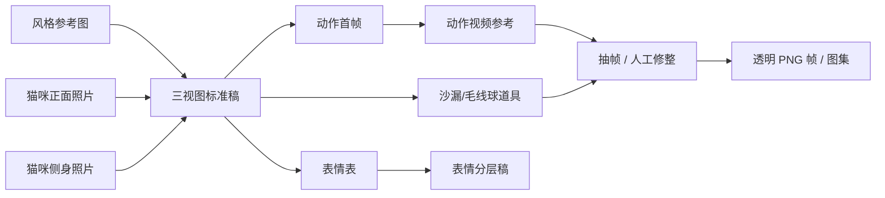

# 「开心」桌宠美术素材 · 生图 / 生视频提示词

| 项目 | 内容 |
| --- | --- |
| 文档版本 | v1.0 |
| 日期 | 2026-10-26 |
| 对应设计文档 | [开心桌宠-设计文档.md](开心桌宠-设计文档.md) |
| 风格参考 | [美术风格参考-水彩动物.png](../Reference/美术风格参考-水彩动物.png) |
| 角色照片 | `IMG_20261015_205417.jpg`、`IMG_20261015_205350.jpg`、`IMG_20261015_205404.jpg` |
| 目标工具 | ImageGen（静帧）、VideoGen（动作参考/视频） |
| 交付对象 | 桌宠角色「开心」、沙漏/毛线球道具、动作视频参考 |

> **流程更新（2026-10-26）：** 美术生产已改为手绘，本文保留作为风格、构图和姿态的参考。当前主计划、帧数、画布和验收标准请看 [美术素材手绘任务清单.md](美术素材手绘任务清单.md)。如果只是想用 AI 快速出草图，本文仍然可用。

---

## 0. 先看这里：生成顺序

不要一开始就分别生成三视图、表情和动作。水彩风格 + 真实猫咪花纹很容易“每一张都像另一只猫”，必须先生成一个**唯一的角色标准**，后面所有素材都从它派生。

推荐顺序：



| 步骤 | 产物 | 用途 |
| --- | --- | --- |
| 1 | 三视图标准稿（A1） | 锁定脸、花纹、身体比例，后续所有图的身份参考 |
| 2 | 坐姿转面稿（A2） | 桌宠主要姿态的参考，便于做 idle/睡觉动作 |
| 3 | 表情表（B1） | 确定眼睛、嘴巴、耳朵的情绪语言 |
| 4 | 表情分层稿（B2） | 眨眼、张嘴、眯眼等叠加层 |
| 5 | 动作首帧（C1–C8） | 供 VideoGen 作为 first frame，保证动作不换猫 |
| 6 | 动作视频（D1–D9） | 动作节奏、姿态、表情的参考 |
| 7 | 沙漏/毛线球（E/F） | 桌宠计时与玩耍的必要道具 |
| 8 | 人工修整 | 抠图、对齐、补帧、生成 PNG 图集 |

> 工具限制：ImageGen 最多同时参考 3 张图；VideoGen 只接受 1 张首帧/参考图。本文的提示词按这个限制编写。
>
> 提示词正文使用英文，因为多数模型对英文的属性描述、否定词和多参考图指令更稳定；如果你使用中文生图平台，可以保留段落结构、整体翻译，但不要删掉“身份锁定词”和“负向提示词”。

---

## 1. 参考图的分工

### 1.1 三张参考图怎么放

| 图片 | 作用 | 用法 |
| --- | --- | --- |
| `美术风格参考-水彩动物.png` | **只作为风格参考** | 借用水彩技法、线稿、纸张肌理、低饱和配色；不要复制图里的兔子、鸭子、花卉、排版、文字或签名 |
| `IMG_20261015_205417.jpg` | **脸/正面身份** | 灰虎斑、小范围白色口鼻/下巴、绿色眼睛、粉色鼻子、额头纹路；白色四肢/爪子保留，照片中的白围兜不使用 |
| `IMG_20261015_205350.jpg` 或 `IMG_20261015_205404.jpg` | **身体/侧身/尾巴身份** | 灰虎斑、体型、尾巴毛量和深色尾尖 |

在 ImageGen 的提示词中明确引用顺序，例如：

> Image 1 is the watercolor style reference only. Image 2 and Image 3 are identity references of my cat. Do not copy the flowers, other animals, layout, text, or signature from Image 1.

### 1.2 生成后续素材时怎么保持一致性

1. 先生成并选定一张 A1 三视图。
2. 如有花纹、眼形、口鼻白色范围或胸口花纹错误，用 ImageGen 的编辑/重生成修正，**保留其他特征不变**。
3. 把选定的 A1 作为“角色标准图”，在后续生成中始终作为 Image 1 或 Image 2 传入。
4. 风格参考图仍然保留在参考图列表中，负责水彩质感。
5. 每次生成只改一个变量（表情、姿势、道具之一），不要一次改多个条件。

修正提示词模板：

```text
Keep the character completely identical to the approved character sheet: same face, same tabby markings, same proportions, same eye color and nose color, the same small white muzzle and chin, and the same natural white fur on all four legs and paws. Do not add a white bib, white chest patch, or white throat. Do not add actual gloves, shoes, clothing, or accessories; the white on the legs is fur, not garments. Only change [具体修改项]. Do not change the pose, background, lighting, or art style.
```

### 1.3 风格边界与版权说明

- 参考图是一张商业水彩贴纸合集（图片署名：Kreker Kate），本文只把它当作**风格方向**，不直接裁切、描摹、重绘其具体动物或花卉构图。
- 生成提示词里不直接写作者姓名，只描述可观察的风格特征，避免模型复刻特定作品。
- 生成的素材用于个人自用桌宠；如果以后要公开分发，需要重新确认角色、道具和素材的授权。
- 不要把参考图原图打包进软件安装包；它只留在工作目录作为风格参考。

---

## 2. 风格与角色「锁定词」

下面的两段英文可以复制到每个静帧提示词前面。保持在所有素材中完全一致。

### 2.1 风格锁定词

```text
Style lock: delicate children's-book watercolor illustration, fine graphite and ink contour lines, transparent watercolor washes, subtle warm paper grain inside the painted shapes, muted earthy palette of warm cream, sage green, dusty rose, pale butter yellow, terracotta and soft grey-brown, gentle diffuse lighting, soft hand-painted edges, quiet and cozy mood. Not photorealistic, not 3D, not CGI, not thick cartoon outline, not glossy digital airbrush, not neon or highly saturated.
```

中文要点：

- 细线稿 + 透明水彩薄涂，纸纹只在角色内部，不能是一整张矩形纸张。
- 主色是奶油白、鼠尾草绿、尘土玫瑰、淡黄油色、赭石、暖灰棕。
- 光线柔和漫射，没有强烈投影。
- 不要写实毛发光影，不要 3D，不要粗黑描边，不要数字气笔。

### 2.2 角色身份锁定词

```text
Character identity lock: one young domestic shorthair cat, grey-brown tabby with irregular dark grey stripes and a clear M-shaped tabby mark on the forehead, a small white muzzle and chin that stops at the chin, no white bib, no white chest patch, no white throat, a tabby chest and upper body, natural white fur on all four legs and paws (this white is fur, not clothing), large clear soft green eyes, a small dusty pink nose, a fluffy tail with a darker tip, natural cat proportions, no collar, no bell, no actual gloves, no shoes, no clothing, no accessories. The markings must stay exactly the same in every view and every frame.
```

中文要点：

- 一只灰棕虎斑猫，额头 M 纹、仅小范围白色口鼻/下巴（白色止于下巴，不延伸到脖子）、绿眼、粉鼻、深色尾尖。
- 白色四肢与爪子保留，是自然毛色，不是袜子/手套等衣物。
- 无白围兜、白胸口；胸口和上半身是虎斑。
- 不佩戴项圈、铃铛、真实手套、袜子、鞋、衣服或任何配饰。
- 所有帧的花纹位置一致，不能“每张都换一只猫”。
- 可以适度美化，但不要把脸改成完全不同的品种；保留照片里的脸部比例和眼神。

### 2.3 画布与镜头约定

| 素材类型 | 推荐尺寸/比例 | 背景 | 相机 |
| --- | --- | --- | --- |
| 三视图 A1 | 1536×1024（3:2） | 暖白水彩纸 | 正交平视，无透视 |
| 坐姿转面 A2 | 1536×1024（3:2） | 暖白水彩纸 | 正交平视 |
| 表情表 B1 | 1024×1024（1:1） | 暖白水彩纸 | 固定 3/4 正面，头部居中 |
| 分层表情 B2 | 1024×1024（1:1） | 暖白或纯色 | 固定头部角度 |
| 动作首帧 C | 1024×1024 或 1280×720 | 纯色哑光背景 | 固定 3/4 侧视，全身入镜 |
| 动作视频 D | 1280×720（16:9） | 纯色哑光背景 | 固定机位，不推拉、不切镜 |
| 沙漏/毛线球 E/F | 1536×1024 | 概念稿暖白；生产稿纯色 | 正交平视 |

生产用纯色背景推荐：**中等明度的鼠尾草绿 `#8FAF9A`**。它和白色四肢、白色口鼻、浅色毛发有足够对比，比纯绿幕更不伤水彩边缘；不要用纯白背景做最终抠图，白色四肢和口鼻会和纸底混在一起。

---

## 3. 资产清单

| 编号 | 资产 | 数量/输出 | 说明 |
| --- | --- | --- | --- |
| A1 | 标准三视图 | 1 张 1536×1024 | 正面、侧面、背面；脸部细节另用表情表/头部特写补足 |
| A2 | 坐姿转面 | 1 张 1536×1024 | 正面、3/4 侧面、背面；桌宠主姿态 |
| B1 | 表情表 | 1 张 1024×1024 | 3×3 九宫格 |
| B2 | 眼部/嘴部分层 | 1 张 1024×1024 | 眨眼和张嘴的叠加素材 |
| C1–C8 | 动作首帧 | 8 张（C9 可复用 C3） | 供 VideoGen 使用 |
| D1–D9 | 动作视频 | 9 段 4–6 秒（D5 可到 8 秒） | 动作参考；其中 D9 可选 |
| E1–E2 | 沙漏设定与分层 | 2 张 | 计时道具，不能带数字 |
| F1–F2 | 毛线球设定与旋转 | 1–2 张 | 玩耍道具 |
| G1 | 应用/托盘图标参考 | 1 张 | 可选，但建议做 |

---

## 4. 三视图提示词

### 4.1 A1：标准三视图（第一张必须生成的图）

英文提示词（复制使用，并上传风格图 + 2 张猫咪照片）：

```text
Use Image 1 as the watercolor style reference only. Do NOT copy the flowers, other animals, layout, text, or signature from Image 1. Use Image 2 and Image 3 as the identity references for my cat.

Create a clean character design turnaround sheet of exactly one young cat, with exactly three full-body views: front view, left side profile, back view. The cat stands naturally on the same invisible ground line, with the full body, tail and ears visible, no cropping. Same scale and same proportions in all three views, orthographic, no perspective. Keep the sheet clean with only these three full-body views; no extra head inset, no collage.

Character identity lock: one young domestic shorthair cat, grey-brown tabby with irregular dark grey stripes and a clear M-shaped tabby mark on the forehead, a small white muzzle and chin that stops at the chin, no white bib, no white chest patch, no white throat, a tabby chest and upper body, natural white fur on all four legs and paws (this white is fur, not clothing), large clear soft green eyes, a small dusty pink nose, a fluffy tail with a darker tip, natural cat proportions, no collar, no bell, no actual gloves, no shoes, no clothing, no accessories. The markings must stay exactly the same in every view.

Style lock: delicate children's-book watercolor illustration, fine graphite and ink contour lines, transparent watercolor washes, subtle warm paper grain inside the painted shapes, muted earthy palette of warm cream, sage green, dusty rose, pale butter yellow, terracotta and soft grey-brown, gentle diffuse lighting, soft hand-painted edges, quiet and cozy mood. Not photorealistic, not 3D, not CGI, not thick cartoon outline, not glossy digital airbrush, not neon or highly saturated.

Composition: three views evenly spaced in a row, generous white margins, centered, clean warm-white watercolor paper background, no cast shadow, no floor, no props. No text, no labels, no arrows, no signature, no watermark. Only this one cat, repeated three times; no other cats, no rabbits, no ducks, no flowers, no botanical border.
```

负向提示词：

```text
photorealistic, photograph, 3D render, CGI, digital airbrush, thick black outlines, glossy fur, neon colors, oversaturated, extra cats, second cat, other animals, rabbits, ducks, geese, frog, flowers, floral border, leaves frame, text, letters, numbers, labels, watermark, signature, human hands, collar, bell, actual gloves, leg warmers, shoes, clothing, white bib, white chest patch, white throat, accessories, extra limbs, extra tail, missing paw, five legs, cropped ears, cropped tail, cropped paws, different eye color, white eyes, glowing eyes, blurry, low resolution, busy background, paper shadow, drop shadow
```

生成后检查：

- 三只猫是否是同一只？虎斑花纹、口鼻白色范围、白色四肢和尾尖是否一致？
- 正面、侧面、背面的胸口是否保持虎斑、没有白围兜？四肢的白色是否连贯，且像自然毛色而不是衣物？
- 四只脚是否都在？尾巴是否被裁切？
- 额头 M 纹、鼻子粉色、眼睛绿色是否一致？
- 背景是否是干净的暖白纸，而不是带阴影的桌面？

### 4.2 A2：坐姿转面（桌宠主姿态）

英文提示词（使用 A1 作为 Image 1，风格图作为 Image 2）：

```text
Use Image 1 as the approved character identity sheet and Image 2 as the watercolor style reference. Create a second turnaround sheet of exactly the same cat, now sitting naturally: one front view, one three-quarter left view, one back view. Keep the same scale, proportions and tabby markings in every view; only a small white muzzle and chin, no white bib, no white chest patch, tabby chest and upper body, natural white fur on all four legs and paws (fur, not clothing; no actual gloves or garments); same green eyes, pink nose and dark tail tip. The cat sits upright with the tail curled neatly around the body; all four paws visible where the view allows. Orthographic, no perspective, same invisible ground line. Warm-white watercolor paper background, no shadow, no props, no flowers, no text, no labels, no other animals.
```

要点：

- 坐姿是 idle、睡觉、专注陪读的基础，比站姿更重要。
- 尾巴的位置要可复用：坐着时绕在身侧，趴下时能自然收拢。
- 侧视图要能看清身体厚度、胸口虎斑的范围、白色四肢的起点和后腿的折叠方式。

### 4.3 三视图的使用方式

- A1 不直接作为游戏贴图，而是**身份锚点**；后续所有首帧、表情、道具都带上它。
- 如果需要更清晰的脸部细节，用 B1 表情表的单格或单独生成“头部特写”，不要把额外的头塞进三视图，避免模型把每一格都当成不同的猫。
- 只保留选定的一张作为 `character-bible.png`；不要同时用多张三视图，否则模型会混淆。
- 若三视图中有局部错误，优先用局部编辑修正，不要整张重生成。

---

## 5. 表情表提示词

### 5.1 B1：3×3 表情九宫格

英文提示词（使用 A1 角色标准图 + 风格图）：

```text
Use Image 1 as the approved character identity sheet and Image 2 as the watercolor style reference. Create a clean 3x3 expression sheet containing exactly one cat head and shoulders, repeated nine times in a neat grid. Keep the exact same head angle (front three-quarter), same scale, same eye color, same nose color, same small white muzzle and chin, no white bib and no white chest, same fur stripes, same lighting, and same watercolor style in every cell. Do not change the body or add any clothing or accessories.

Expressions, left to right, top to bottom:
1. neutral and calm, ears relaxed
2. relaxed blink, eyes half closed
3. happy and content, eyes closed in a soft arc, tiny smile
4. sleepy, eyelids heavy, head slightly lowered
5. curious, eyes wide, ears slightly forward
6. mildly annoyed, ears slightly back, mouth a small line
7. meowing, mouth open, soft pink tongue visible, eyes open
8. focused, pupils slightly narrowed, ears forward, alert but calm
9. petted bliss, eyes closed, head tilted slightly into an invisible hand

Style: delicate watercolor children's-book illustration, fine graphite/ink line, transparent washes, subtle paper grain, muted earthy palette, warm cream background, no heavy shadows. The expressions must be readable at a small size, using eye shape, ear position and mouth shape rather than exaggerated human expressions.

No text, no labels, no numbers, no speech bubbles, no extra cats, no flowers, no props, no border, no signature, no watermark. Only the nine heads of the same cat.
```

负向提示词：

```text
extra cats, multiple bodies, different cat, different markings, different eye color, different nose color, human facial expressions, human teeth, human hands, text, labels, numbers, speech bubbles, emoji, thick outline, 3D, photorealistic, neon, oversaturated, background scenery, flowers, collar, hat, exaggerated cartoon, distorted ears, missing ears, asymmetric eyes, crossed eyes, blurry
```

### 5.2 九种情绪的使用场景

| 表情 | 桌宠场景 |
| --- | --- |
| 平静 | 默认待机基线 |
| 放松眨眼 | 随机眨眼、眨眼叠加层 |
| 开心眯眼 | 被摸、专注完成、玩耍 |
| 困倦 | 睡前、长时间无操作 |
| 好奇 | 用户开始专注、鼠标靠近 |
| 轻微不满 | 连续拖动、被吵醒 |
| 张嘴喵 | 交互音效、请求注意 |
| 专注警觉 | 看到毛线球、扑击前 |
| 被摸陶醉 | 单击猫身体、呼噜声配合 |

### 5.3 B2：眼部/嘴部分层稿

做动画时不要为每一个表情重画整颗头；至少准备眼睛和嘴部的独立层。

```text
Use Image 1 as the approved character identity sheet and Image 2 as the watercolor style reference. Create an animation-friendly facial feature sheet of exactly the same cat head, fixed front three-quarter angle, aligned on the same eye line and head center. Arrange a clean grid of isolated facial states on a plain warm-white background: row 1 - eyes open, eyes half closed, eyes fully closed; row 2 - mouth closed neutral, mouth open small meow, mouth open wide meow; row 3 - ears forward, ears relaxed, ears slightly back. Draw each state as a clean separate element with the same watercolor style, same eye color, same nose, same muzzle markings. No complete second head, no text, no labels, no borders, no shadows.
```

如果模型无法保持对齐，让生成的图只负责“表情素材参考”，最终眼睛/耳朵/嘴的图层由你用 Procreate/Photoshop 重绘并对齐；这比逐帧修补 AI 的输出更稳定。

---

## 6. 动作首帧提示词（C 系列）

动作视频必须由**首帧**驱动，否则猫会在视频中换脸、换花纹。首帧使用已经锁定的角色标准图生成。

### 6.1 通用首帧模板

```text
Use Image 1 as the approved character identity sheet and Image 2 as the watercolor style reference. Create one single keyframe of the same cat: [POSE DESCRIPTION]. Full body visible, centered, [ANGLE], calm natural proportions, same tabby markings, a tabby chest and upper body, natural white fur on all four legs and paws (not clothing; no actual gloves or garments), only the same small white muzzle and chin, same green eyes and pink nose, same dark tail tip.

Style: delicate watercolor children's-book illustration, fine graphite/ink contour, transparent washes, subtle paper grain, muted earthy palette, soft diffuse lighting. Isolated on a flat matte sage-green background (#8FAF9A), no cast shadow, no floor line, no background scenery, no text, no labels, no border, no collage. One cat only. No human hands unless the pose explicitly requires a human hand (it should not).
```

尺寸：1024×1024 或 1280×720；最终只取中间的主体，缩放到 384×384 内的帧画布；按内容裁切后导出。

### 6.2 首帧姿势描述表

| 编号 | 姿势 | 用于视频 | 描述 |
| --- | --- | --- | --- |
| C1 | 坐姿待机 | D1 | sitting upright, three-quarter view, tail curled around the body, front paws together, calm expression |
| C2 | 睡觉蜷缩 | D3 | curled up asleep on the ground, eyes closed, nose tucked toward the tail, tail wrapping the body, side three-quarter view |
| C3 | 放置沙漏 | D6 | sitting beside a small watercolor hourglass, one front paw resting on it, looking at the hourglass, hourglass on the ground to the cat's right |
| C4 | 玩毛线球 | D5 | low crouch, both front paws near a terracotta-and-mustard yarn ball, tail raised, alert eyes |
| C5 | 扑击 | D5 | mid-pounce, body low then forward, front paws extended, ball in front, tail streaming behind |
| C6 | 醒来伸展 | D4 | front paws stretched forward, chest low, back slightly raised, mouth opening in a yawn, tail lifted |
| C7 | 被摸 | D8 | eyes closed, head tilted gently upward, soft blissful expression, no human hand visible |
| C8 | 被拎起 | D9 | suspended as if held by the scruff, front paws relaxed and dangling, hind paws hanging, tail curled, no human hand visible |
| C9 | 专注陪读 | D6 / D1 | sitting calmly next to the hourglass, looking toward the screen, tail wrapped, quiet expression |

### 6.3 首帧生成注意事项

- 沙漏和毛线球要在首帧就出现，后面的视频才不容易把道具变形。道具参考图见第 8 节。
- 全身完整入镜，尤其是尾巴和四只爪子；视频裁切后再统一缩放。
- 不要生成数字时间、钟表、文字、符号。时间由应用叠加。
- 背景必须是纯色哑光，不能有水彩纸的矩形纹理，否则抠图会带出白边。
- 如果背景出现渐变或云纹，重新生成；纯色背景是后期透明化的关键。

---

## 7. 动作视频提示词（D 系列）

### 7.1 通用视频模板

VideoGen 使用 `first_frame_to_video`，把对应的 C 首帧作为第一帧。每次只生成 4–6 秒，避免动作变形累积。

```text
Animate the attached first frame. Keep it as the exact first frame of the video. Fixed camera, full body visible, no camera movement, no zoom, no pan, no cuts, no scene change. Preserve the exact same watercolor style, markings, face, proportions, lighting, and flat matte sage-green background in every frame. Natural cat motion, not human-like. No text, no numbers, no watermark, no human hands, no extra limbs, no extra tail, no morphing, no disappearing parts. Duration 5 seconds, 24fps. [MOTION DESCRIPTION]
```

### 7.2 D1：待机循环

首帧 C1。

```text
The cat sits calmly. The chest expands and contracts slowly with breathing. At about 2 seconds it gives one slow blink. At about 3.5 seconds one ear twitches briefly. The tail tip sways gently side to side. The front paws stay planted and the body does not drift. It returns exactly to the starting pose at the end for a seamless loop. Duration 5 seconds, 24fps.
```

生成要点：

- 呼吸幅度要小，不要整个身体上下漂移。
- 眨眼只眨一次，避免机械式循环。
- 待机视频只作为参考；最终 app 的待机帧可以人工挑 8–12 帧循环。

### 7.3 D2：洗脸/舔毛

首帧 C1（可把首帧稍微调整：一只前爪抬起）。

```text
The cat lifts one front paw, licks the paw twice with a small pink tongue, then wipes the same side of its face once. The head tilts slightly with the wipe. The other paw stays on the ground. It returns to the sitting pose at the end. Calm, slow, cozy motion. Duration 6 seconds, 24fps.
```

### 7.4 D3：睡觉循环

首帧 C2。

```text
The cat stays curled asleep. Only the flank rises and falls with slow breathing. One ear twitches once around 3 seconds. The tail tightens slightly around the body. Eyes remain closed. No head lifting, no standing up. The first and last frames should match for a seamless loop. Duration 6 seconds, 24fps.
```

### 7.5 D4：醒来伸懒腰

首帧 C2 或 C6。

```text
The cat wakes slowly: eyes open, one slow blink, a yawn with the mouth open, then the front paws stretch forward and the chest lowers toward the ground. The tail lifts. Finally it rises back to a calm sitting pose. Smooth, unhurried, natural cat motion. Duration 5 seconds, 24fps.
```

### 7.6 D5：玩毛线球

首帧 C4，毛线球已在画面中。

```text
A small watercolor yarn ball in terracotta and muted mustard rolls into the frame from the right. The cat's pupils widen, it lowers its body, pounces forward, and pats the ball with alternating front paws. The ball rolls a short distance and the cat follows with its eyes, then taps it again. The ball stays inside the frame. The cat's tail sways. No human hands, no string held by a person, no extra toys. Keep the same markings and background. Duration 8 seconds, 24fps.
```

如果 8 秒超出工具限制，拆成两段：扑击 5 秒 + 拍球 5 秒，后期剪接。不要在一个提示词里要求太复杂的多段动作。

### 7.7 D6：搬出沙漏

首帧 C3 或 C9。这是番茄钟的核心动作。

```text
The cat sits beside a small watercolor hourglass. It reaches out with one front paw and pushes the hourglass a few centimeters to the right, then pats it gently until it stands upright. The cat settles back into a calm sitting pose next to the hourglass, looking toward it once. The hourglass remains upright on the ground. No numbers, no clock, no text, no human hands. Keep the cat and hourglass fully in frame. Duration 5 seconds, 24fps.
```

### 7.8 D7：轻碰/翻转沙漏

首帧 C3 或 C9。计时结束“把沙漏收走”的动作用 D6 倒放即可，不必单独生成。

```text
The cat taps the top of the small hourglass with one front paw. The hourglass tips over and lands upright again on its other side, with the sand now at the top. A little sand settles. The cat sits back and watches it. No text, no numbers, no human hands. Duration 4 seconds, 24fps.
```

沙色切换在应用里完成：视频只生成中性沙色，后期将沙层染成专注金或休息绿，避免每一段视频都生成两种颜色。

### 7.9 D8：被摸反应

首帧 C7。

```text
The cat closes its eyes, gently tilts its head upward toward an invisible hand, and leans slightly into the touch. A soft content expression. The invisible hand never appears on screen. The tail relaxes. It slowly opens its eyes and returns to the starting position. Duration 4 seconds, 24fps.
```

### 7.10 D9：被拎起/悬空（可选）

首帧 C8。这个动作建议只做静帧 + 程序化摆动；AI 视频很容易生出多余的腿或人手。

```text
The cat is gently suspended as if held by the scruff. No human hand visible. The front paws hang relaxed, the hind paws dangle, the tail curls upward. The body sways slightly with a gentle vertical bob. Keep the cat fully in frame and the markings stable. Duration 4 seconds, 24fps.
```

### 7.11 视频生成的负面提示词

在每次视频生成时附上：

```text
camera movement, zoom, pan, cuts, scene change, morphing, changing markings, different cat, extra cat, extra limbs, extra tail, missing paw, disappearing tail, human hands, human arms, text, numbers, clock, digits, watermark, signature, background gradient, flowers, other animals, photorealistic, 3D render, thick outlines, flicker, jitter, low resolution, blurred face
```

### 7.12 视频后期

- 从视频中抽帧：待机/睡觉 12fps，玩耍/拖拽 24fps；每个动作只保留 20–40 个关键帧，不用把每一帧都放入 app。
- 固定机位、纯色背景让抽帧对齐更容易；以猫的前爪落地点为锚点，统一裁切到 384×384 母版。
- 背景用专业抠图工具（Photoshop 的“选择主体/蒙版”、Affinity、或专门的 matting 工具），不要用魔棒硬抠水彩边缘。
- 对抗水彩边缘的杂色：用 1–2px 的柔化蒙版，测试 100% 与 150% 缩放下的白边。
- AI 视频中变形的手爪/尾巴，直接在 Photoshop/Procreate 里重绘，不要带进最终图集。
- 第一帧和最后一帧接近的片段保留；不接近的用交叉淡入或手工补帧。
- 逐帧检查纸纹和线稿是否闪烁；若明显，统一用一张固定纸纹叠在所有帧上，或去掉纸纹、只在角色边缘保留少量颗粒。

---

## 8. 沙漏与毛线球道具

### 8.1 沙漏的视觉设定

- 尺寸：约 55×80 DIP（app 内），生产稿至少 2x。
- 暖浅木色上下盖，细黄铜/深木色支柱，透明玻璃，沙漏内部有细沙。
- 沙色：专注暖金 `#D9B36C`，休息鼠尾草绿 `#9BB68C`。
- **绝不能有数字、刻度、文字、钟表盘**；精确时间由 app 的时间标签显示。
- 可以在底座旁边加一小枝鼠尾草/细叶作为水彩点缀，但不要喧宾夺主。

### 8.2 E1：沙漏概念设定稿

```text
Use Image 1 as the watercolor style reference only. Create a clean prop design sheet of one small hourglass, not attached to any cat: front view, side view, and an empty / half-full / full sand state arranged in a row. Warm light wood top and bottom caps, thin dark wood or antique brass supports, clear glass bulbs, fine pale golden sand, a tiny muted sage botanical sprig optional near the base. Delicate watercolor children's-book illustration, fine graphite/ink contour, transparent washes, subtle paper grain, muted earthy palette. Warm-white paper background, no shadow, no text, no numbers, no clock face, no labels, no border, no other props, no cats, no animals.
```

### 8.3 E2：生产用沙漏分层

生产素材建议拆成：

1. 空沙漏（木框 + 玻璃 + 高光）
2. 上层沙
3. 下层沙
4. 落沙（细线/点）
5. 翻转状态（整体旋转 180°，或用同一素材在代码中翻转）

生成提示词：

```text
Use Image 1 as the approved hourglass reference. Create a production asset sheet of the exact same hourglass on a flat matte sage-green background (#8FAF9A), orthographic front view, centered, no shadow, no text, no numbers. Show five states in a horizontal row, same size and same anchor point: 1) empty glass, 2) top chamber half full, bottom empty, 3) top chamber full, bottom empty, 4) top chamber half full, bottom half full, 5) top empty, bottom full. Keep the wooden caps and glass outline identical in every state. The sand should be pale neutral gold so it can be color-tinted in the app. No cat, no hands, no table, no background texture.
```

如果模型无法做出整齐的五联图，就分别生成“空沙漏”“上层沙”“下层沙”三张，用同一张参考图锁定外形，再在图像软件中手动对齐。对于 app 来说，分层比一张正确但不可拆的图更有价值。

### 8.4 F1：毛线球

```text
Use Image 1 as the watercolor style reference only. Create a prop sheet of one ball of watercolor yarn, not attached to a cat: terracotta and muted mustard threads, a loose strand curling out, eight rotation states arranged in a clean 4x2 grid, all the same size and same yarn design. Delicate watercolor children's-book illustration, fine graphite/ink contour, transparent washes, subtle paper grain, warm-white paper background, no shadow, no text, no labels, no border, no cats, no needles, no hands.
```

生产时改用纯色背景，逐帧旋转并抠图；app 里只需要 8 个旋转帧 + 物理模拟，不需要视频。

### 8.5 G1：应用和托盘图标（可选）

```text
Create a simplified app icon featuring the same grey-brown tabby cat head with a small white muzzle and chin, no white bib, grey-brown tabby chest, green eyes and pink nose, no collar, no accessories, centered in a square composition. Soft watercolor children's-book style with a clean silhouette, a tiny muted sage-green phase dot at the lower right, high legibility at 16x16 pixels, no text, no letters, no border, no complex background. Provide one version on warm cream and one on transparent-looking plain background.
```

托盘图标最终建议手绘/矢量化简，不要依赖 AI 在 16px 下的细节。

---

## 9. 负向提示词总表

### 9.1 静帧

```text
photorealistic, photograph, 3D render, CGI, digital airbrush, thick black outline, glossy plastic, neon, oversaturated, harsh lighting, heavy shadow, extra cat, other cat, multiple cats, dog, rabbit, duck, goose, frog, mouse, squirrel, flowers, floral border, botanical frame, background scenery, grass, table, floor shadow, human hands, human arms, human face, collar, bell, bow, actual gloves, leg warmers, shoes, clothing, hat, white bib, white chest patch, white throat, accessories, extra limbs, extra tail, missing paw, five legs, cropped ears, cropped tail, cropped paws, different markings, different eye color, different nose color, closed white eyes, text, letters, numbers, labels, arrows, speech bubble, watermark, signature, logo, low resolution, blurry, distorted anatomy, crossed eyes
```

### 9.2 视频追加

```text
camera movement, zoom, pan, tilt, cuts, scene change, morphing, flicker, jitter, paper grain flicker, texture boiling, line flicker, changing markings, different cat, extra cat, extra limbs, extra tail, missing paw, disappearing tail, human hands, human arms, white bib appearing, white chest patch appearing, actual gloves appearing, clothing appearing, text, numbers, clock, digits, watermark, signature, background gradient, flowers, props appearing or disappearing, cat leaving frame
```

### 9.3 背景/构图追加

- 概念稿：`warm-white watercolor paper, no shadow, no floor, no props`。
- 生产稿：`flat matte sage-green #8FAF9A background, no gradient, no texture, no shadow, subject isolated`。
- 三视图：`orthographic, same scale, same ground line, no perspective, all paws and tail visible`。
- 表情表：`one head repeated in a neat grid, identical angle and scale, no body, no labels`。

---

## 10. 生成参数与工作流

### 10.1 ImageGen

| 用途 | 参考图 | 尺寸 | 备注 |
| --- | --- | --- | --- |
| A1 三视图 | 风格图 + 两张猫咪照片 | 1536×1024 | 先生成，选最好的一张 |
| A2 坐姿转面 | A1 + 风格图 | 1536×1024 | 保持同一只猫 |
| B1 表情表 | A1 + 风格图 | 1024×1024 | 九宫格，无文字 |
| B2 表情分层 | A1 + 风格图 | 1024×1024 | 眼睛/嘴/耳朵分开 |
| C 动作首帧 | A1 + 风格图 | 1024×1024 或 1280×720 | 纯色背景 |
| E 沙漏 | 风格图；后续用沙漏稿 | 1536×1024 | 无数字 |
| F 毛线球 | 风格图 | 1536×1024 | 8 个旋转帧 |

注意：

- 同一轮最多 3 张参考图；如果还需要姿势照片，优先保 A1 + 风格图，姿势用文字描述。
- 生成 2–4 个候选，选身份最稳定的一张；不要只看“好不好看”，先看虎斑花纹、口鼻白色范围、白色四肢是否连贯，以及胸口是否没有白块、猫身上是否被画上真实衣物/配饰。
- 使用固定的种子/参数（如果你的工具支持），并记录在迭代日志中。

### 10.2 VideoGen

| 动作 | 首帧 | 时长 | 帧率 | 背景 | 循环 |
| --- | --- | --- | --- | --- | --- |
| D1 待机 | C1 | 5s | 24fps | 纯鼠尾草绿 | 是 |
| D2 洗脸 | C1 变体 | 6s | 24fps | 纯鼠尾草绿 | 否 |
| D3 睡觉 | C2 | 6s | 24fps | 纯鼠尾草绿 | 是 |
| D4 醒来 | C2/C6 | 5s | 24fps | 纯鼠尾草绿 | 否 |
| D5 玩球 | C4 | 6–8s（可拆两段） | 24fps | 纯鼠尾草绿 | 否 |
| D6 搬沙漏 | C3 | 5s | 24fps | 纯鼠尾草绿 | 否 |
| D7 翻沙漏 | C3/C9 | 4s | 24fps | 纯鼠尾草绿 | 否 |
| D8 被摸 | C7 | 4s | 24fps | 纯鼠尾草绿 | 否 |
| D9 被拎起 | C8 | 4s | 24fps | 纯鼠尾草绿 | 可选 |

- 使用 `first_frame_to_video`，不要用纯文字的 `text_to_video`，否则猫会变脸。
- 一次只生成一个动作；不要把“玩球 + 打哈欠 + 睡觉”写在同一段。
- 视频尺寸建议 1280×720；如果只做全身坐姿，也可以用 720P/1080P 并后期裁切。
- 24fps 是动作参考的目标采样率；如果工具没有帧率参数，生成后统一抽帧/重定时到 24fps，再挑选关键帧。
- 视频生成后先看稳定性：花纹、眼睛、四只脚、尾巴、沙漏形状是否一直在；有变形就重来或只取前几秒。

### 10.3 迭代策略

1. **先身份，后风格**：身份不对，风格再美也不用。
2. **先特写，后动作**：脸部稳定后再做全身动作。
3. **先静帧，后视频**：永远用首帧驱动视频。
4. **一次只改一个变量**：表情、姿势、道具、背景分开调。
5. **接受不完美**：AI 负责氛围和动作参考，最终帧通过人工修整补齐手爪、尾巴、花纹和透明边缘。
6. **固定纸纹**：不要让每一帧重新生成一套纸纹；水彩纸纹逐帧变化会“沸腾”。生产帧要么把纸纹压到几乎不可见，要么在后期给所有帧统一叠加同一张固定纸纹（或用运行时统一纹理），并逐帧检查线稿是否闪烁。
7. **保留源文件**：每张图保留 prompt、参考图、seed、日期；后续修图时不要覆盖原稿。

---

## 11. 交付规格与质检

### 11.1 文件命名

```text
art-source/
  character/
    A1-three-view.png
    A2-sitting-turnaround.png
    B1-expressions-3x3.png
    B2-face-layers.png
    C1-idle.png
    C2-sleep.png
    C3-hourglass.png
    C4-yarn-play.png
    C5-pounce.png
    C6-stretch.png
    C7-petting.png
    C8-held.png
  props/
    E1-hourglass-concept.png
    E2-hourglass-states.png
    F1-yarn-sheet.png
  video-reference/
    D1-idle.mp4
    D2-groom.mp4
    D3-sleep.mp4
    D4-stretch.mp4
    D5-yarn-play.mp4
    D6-hourglass-place.mp4
    D7-hourglass-flip.mp4
    D8-petting.mp4
    D9-held.mp4             # 可选
  final/
    characters/kaixin/{idle.png,sleep.png,play.png,reactions.png}
    props/{hourglass.png,yarn.png}
```

### 11.2 身份检查表

- [ ] 额头 M 纹和照片一致，三视图/表情/视频中位置不漂移。
- [ ] 四肢的白色毛连贯、自然，不是袜子/手套等衣物；白色四肢与白色口鼻/下巴一致。
- [ ] 胸口和脖颈是虎斑，没有白围兜或大块白胸。
- [ ] 眼睛是柔和的绿色，瞳孔大小随情绪变化但不换色。
- [ ] 鼻子是灰粉色，鼻梁/嘴套的白色范围一致。
- [ ] 尾巴蓬松，尾尖颜色更深，始终可见（除非睡姿自然遮挡）。
- [ ] 没有项圈、铃铛、衣服、花朵或额外装饰。
- [ ] 每次只出现这一只猫；没有兔子、鸭子、狗或第二只猫。

### 11.3 三视图检查表

- [ ] 正面、侧面、背面等高等宽、同一条地平线。
- [ ] 四只爪子完整，尾巴不被裁切，耳朵不裁切。
- [ ] 侧面能看出胸白、虎斑走向、后腿折叠关系。
- [ ] 背面能看到背部和尾巴的花纹逻辑，不出现“凭空多出白围兜”，也不把白色四肢画成衣物。
- [ ] 头部特写和全身的花纹一致。

### 11.4 表情检查表

- [ ] 九宫格每格头部大小一致、朝向一致。
- [ ] 九种情绪在缩到 48px 宽时仍能分辨（至少眼睛/耳朵/嘴的轮廓不同）。
- [ ] 没有人类牙齿、人类表情、夸张的卡通符号。
- [ ] 没有文字、标签、气泡。

### 11.5 视频检查表

- [ ] 机位固定，无推拉、无切镜。
- [ ] 猫不离开画面，四只脚和尾巴不被切掉。
- [ ] 虎斑花纹、白色四肢、绿眼、粉鼻在所有帧一致；胸口没有白围兜，猫没有穿任何衣物/配饰。
- [ ] 没有多余肢体、消失的尾巴、融化的爪子。
- [ ] 没有文字、数字、钟表、水印、人手。
- [ ] 沙漏/毛线球的形状稳定，没有突然变形。
- [ ] 第一帧与最后一帧适合循环（待机/睡觉）。

### 11.6 生产图检查表

- [ ] 背景是纯色可抠图，不是渐变或纸纹。
- [ ] 白色四肢/口鼻边缘没有严重白边或绿边。
- [ ] 猫的底部锚点（前爪/趴卧接触点）清楚，方便对齐。
- [ ] 每帧裁切到统一的 384×384 母版（2x），保留安全边距。
- [ ] 输出 PNG-24 + 透明 alpha；不把纸张背景和阴影烘焙进去。
- [ ] 最终图集体积控制在 12MB 内，单帧解码内存受 LRU 控制，不超过 24MB。

---

## 12. 迭代记录模板

每次生成后记录，避免“这张好看但不知道怎么复现”。

| 日期 | 资产 | 工具/模式 | 参考图 | 提示词版本 | Seed | 输出文件 | 问题 | 处理 |
| --- | --- | --- | --- | --- | --- | --- | --- | --- |
| 2026-10-26 | A1 三视图 | ImageGen | 风格图 + 照片 1/2 | v1.0 | 待填 | A1-v1.png | 胸口出现白围兜 | 局部重生成 |
|  |  |  |  |  |  |  |  |  |

建议每次保留 2–3 个候选，按「身份一致性 > 水彩质感 > 构图」排序选择。身份的优先级永远高于漂亮。

---

## 13. 快速开始：三条可直接复制的提示词

### 13.1 先做三视图

```text
Use Image 1 as the watercolor style reference only. Do NOT copy its animals, flowers, layout, text, or signature. Use Image 2 and Image 3 as the identity references of my cat. Create a character turnaround sheet of exactly one young cat: front view, left side view, back view, full body, natural standing pose, same scale, orthographic. Character: grey-brown tabby, M mark on forehead, a small white muzzle and chin that stops at the chin, a tabby chest and upper body with no white bib and no white chest patch, natural white fur on all four legs and paws (fur, not clothing; no actual gloves, garments or accessories), green eyes, pink nose, fluffy tail with a darker tip, no collar. Delicate children's-book watercolor, fine graphite/ink line, transparent washes, muted cream/sage/dusty rose/terracotta palette, warm-white paper background, no shadow, no props, no flowers, no other animals, no text, no labels, no signature.
```

### 13.2 再做表情九宫格

```text
Use Image 1 as the approved character sheet and Image 2 as the watercolor style reference. Create a clean 3x3 expression sheet with one cat head repeated nine times at the identical angle and scale: neutral, relaxed blink, happy closed-eye smile, sleepy, curious, mildly annoyed, meowing with mouth open, focused, petted bliss. Keep identical markings, green eyes, pink nose, white muzzle, and warm-white paper background. Delicate watercolor, fine linework, no text, no labels, no speech bubbles, no extra cats, no flowers.
```

### 13.3 再做第一段待机视频

1. 用 C1 首帧提示词生成一张坐姿全身图，背景使用 `#8FAF9A` 纯色。
2. 将该图作为 VideoGen 的 first frame，使用 D1 的动作描述。
3. 生成 5 秒 24fps，检查花纹、四爪、尾巴和背景是否稳定。
4. 稳定后，再继续做睡觉、玩耍、沙漏动作。

---

## 14. 与开发交付的衔接

本项目的桌宠不是视频播放器，而是 **PNG 帧序列 + 图层合成**：

- 视频只作为动作参考；最终进入软件的是透明 PNG 帧。
- 猫高约 150 DIP，按 2x 制作，单帧母版 384×384 内；统一底部中心锚点。
- 待机、睡觉帧率低（8–12fps / 6fps），玩耍和拖拽可到 24fps；不要把 60fps 视频原样塞进 app。
- 沙漏、毛线球是独立道具层；沙漏沙量由代码根据计时进度控制，不烘焙时间数字。
- 时间数字由 WPF 时间标签渲染，位于沙漏上方；不要生成到美术素材里。
- 所有最终资源使用 [开心桌宠-设计文档.md](开心桌宠-设计文档.md) 第 8.5.4 节的目录与 JSON 格式。

如果本轮先只做一张图，请优先完成 **A1 三视图**；它是后续所有素材的身份锚点，也是整个桌宠气质的第一张定稿。
